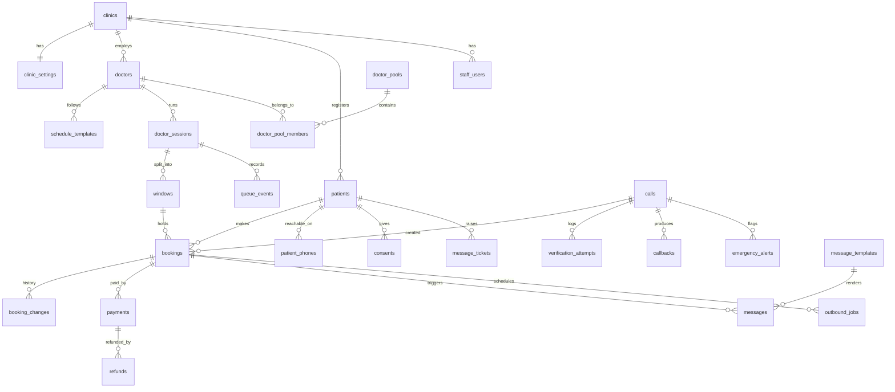

# Demo database

- `schema.sql` - PostgreSQL 14+ schema (needs the `btree_gist` extension)
- `seed.sql` - one demo clinic; Dr Sharma and Dr Verma (general, "General check-up" pool, no fees), Dr Kaur (paediatrics specialist: appointment fee 200, priority fee 500); today's evening session for all three (windows 1-6, 7-12, 13-18; priority places only for Dr Kaur); two patients sharing a phone; a card holder and dependant sharing an institute ID; info answers; 10 SMS and 4 WhatsApp templates
- `002_runtime.sql` - prototype runtime: call phase, transcript segments, decision traces, recordings, handoff, report status, previous interactions. Applied cleanly on Postgres 16 after the two files above
- `seed_runtime.sql` - fictional caller personas, report statuses, and visit history for the prototype
- `tests/schema.test.mjs` - 72 checks run against an in-process Postgres (PGlite): patient ID check digits, existing and institutional IDs, capacity with priority places, specialists-only priority, appointment fee and fee consent, payment rules, refund cap, message templates per channel, doctor/window consistency, pool membership and rollover, expired holds, overlapping windows, queue order, cancellation, the move after the delay cap

```
psql "$DATABASE_URL" -f db/schema.sql
psql "$DATABASE_URL" -f db/seed.sql
psql "$DATABASE_URL" -f db/002_runtime.sql
psql "$DATABASE_URL" -f db/seed_runtime.sql

# tests (from any folder with @electric-sql/pglite installed)
node db/tests/schema.test.mjs /path/to/this/repo
```

## Shape



## Main ideas

- **Postgres is the source of truth.** `bookings.gcal_event_id` and `gcal_sync_status` track the Google Calendar mirror, so a calendar failure never loses a booking.
- **Windows hold several patients.** A time-range exclusion cannot protect that, so a trigger locks the window row and counts live bookings. Routine places = capacity minus priority places, unless `priority_released` is set. Held bookings count only while `hold_expires_at` is in the future.
- **Named vs any-doctor (decision 1).** `bookings.booking_mode`; any-doctor bookings carry a `pool_id`. The same trigger checks that the booking's doctor runs the window, and that an any-doctor booking sits with a member of its pool. A rollover is an update of `window_id` and `doctor_id` together, logged in `booking_changes`. Keeping named-doctor bookings with their doctor is an application rule.
- **Priority visits (decision 3).** `priority = 'priority'` needs the quoted fee (`priority_fee_inr`) and, when booked by the agent, the time the caller agreed (`fee_consent_at`). `payment_status` runs pending, paid, waived or refunded. Doctors with no `priority_fee_inr` show no priority places. `session_queue` orders arrived patients priority first, then by arrival.
- **Patient IDs (decision 6).** `patients.patient_code` is generated as 6 digits plus a Luhn check digit (`1000017`), so a misheard or swapped digit is caught before lookup (`luhn_valid`). Existing clinic IDs are stored as they are; `patient_code_norm` (letters and digits, upper case) is what spoken input is matched against. Institution health centres can also store the card holder's institute ID (`holder_code`) and the patient's relation to the holder, so dependants sharing one ID are told apart by name.
- **Fees, payments and refunds (decision 3).** Doctors carry an optional `priority_fee_inr` (specialists only) and `appointment_fee_inr`. A booking stores the fees quoted on the call, the time of the caller's yes and the chosen method (UPI link or cash at the desk). `payments` holds each UPI link or cash collection (the gateway's payment ID is unique, so webhook replays are harmless). `refunds` can only be raised on a paid payment, and a trigger stops refunds that are not rejected or failed from adding up to more than was paid. Refund shares and staff approval live in `clinic_settings`.
- **Delays and the next-patient signal (decisions 12, 13).** `queue_events` records who signalled (doctor, assistant, reception); `doctor_sessions.est_basis` says whether the estimate is live or schedule-only. `bookings.delay_sms_count` enforces the cap; after the cap the agent asks the patient (`after_cap_action = 'ask_patient'`); a move they choose is a new booking with `rescheduled_from`, logged in `booking_changes`.
- **Windows of one session cannot overlap**, enforced by a GiST exclusion constraint (the one place that tool fits).
- **Provisional records:** a patient created by the agent has `file_complete = false` until staff finish the file at check-in.
- **Shared phones:** `patient_phones` links one number to many patients, with a relation. `calls.patient_id` is set only after verification.
- **Webhook safety:** `calls.bolna_execution_id` is unique, so a retried webhook cannot create a second call record. The raw payload is stored for debugging.
- **Settings table** holds every proposed default from `docs/flows/README.md`, so changing a threshold is a data change, not a code change.
- **Console data:** `callbacks` (priority queue), `message_tickets` (refill and messages), `emergency_alerts` (acknowledge), `messages` (SMS and WhatsApp outbox), `payments` and `refunds`, `audit_log` (who did what).
- **Views:** `window_availability` (open routine and priority places per window, delay shift applied), `pool_window_availability` (the same across a pool), `session_queue` (waiting-room order).

## Known gaps

- A cleanup job must cancel expired holds every minute; until then they block the same patient from re-booking that window.
- No medical records, prescriptions or billing tables: out of scope for v1.
- Personal data (names, dates of birth, phone numbers, transcripts) needs a retention rule and encryption at rest before real use.
- Row-level security and per-clinic isolation are not set up (single clinic in the demo).
