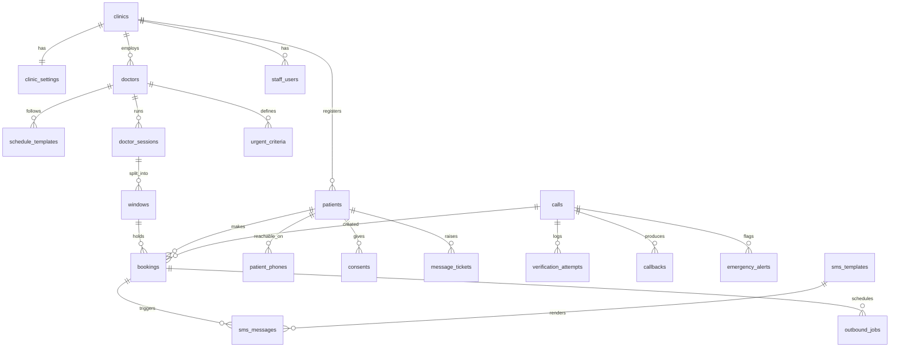

# Demo database

- `schema.sql` - PostgreSQL 14+ schema (needs the `btree_gist` extension)
- `seed.sql` - one demo clinic, doctor, today's evening session with six windows, urgent criteria, info answers and the six starter SMS templates

Both files were run against an in-process Postgres (PGlite) and the capacity rules below were exercised: full windows, urgent places, urgent release, expired holds, duplicate patients, overlapping windows, cancellation freeing a place.

```
psql "$DATABASE_URL" -f db/schema.sql
psql "$DATABASE_URL" -f db/seed.sql
```

## Shape



## Main ideas

- **Postgres is the source of truth.** `bookings.gcal_event_id` and `gcal_sync_status` track the Google Calendar mirror, so a calendar failure never loses a booking.
- **Windows hold several patients.** A time-range exclusion cannot protect that, so a trigger locks the window row and counts live bookings. Routine places = capacity minus urgent places, unless `urgent_released` is set. Held bookings count only while `hold_expires_at` is in the future.
- **Windows of one session cannot overlap**, enforced by a GiST exclusion constraint (the one place that tool fits).
- **Provisional records:** a patient created by the agent has `file_complete = false` until staff finish the file at check-in.
- **Shared phones:** `patient_phones` links one number to many patients, with a relation. `calls.patient_id` is set only after verification.
- **Webhook safety:** `calls.bolna_execution_id` is unique, so a retried webhook cannot create a second call record. The raw payload is stored for debugging.
- **Settings table** holds every proposed default from `docs/flows/README.md`, so changing a threshold is a data change, not a code change.
- **Console data:** `callbacks` (priority queue), `message_tickets` (refill and messages), `emergency_alerts` (acknowledge), `sms_messages` (outbox), `audit_log` (who did what).
- **View `window_availability`** gives the agent open routine and urgent places per window, with the delay shift applied.

## Known gaps

- A cleanup job must cancel expired holds every minute; until then they block the same patient from re-booking that window.
- No medical records, prescriptions or billing tables: out of scope for v1.
- Personal data (names, dates of birth, phone numbers, transcripts) needs a retention rule and encryption at rest before real use.
- Row-level security and per-clinic isolation are not set up (single clinic in the demo).
