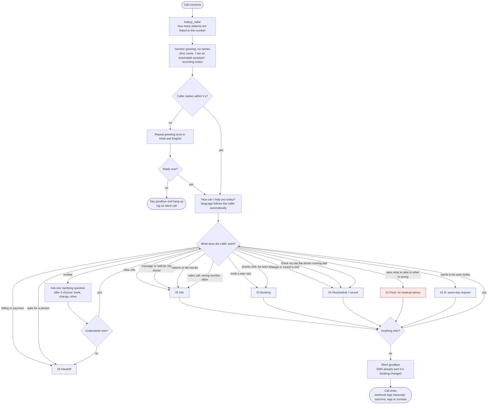
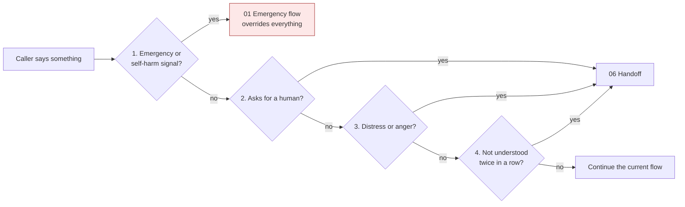

# 00 - Call router

## Main flow

## Global interrupts (checked on every caller turn, in this order)

## Rules the diagrams do not show

- The agent never greets by name. Anyone can pick up a phone, and the caller is unverified until 02 passes. The number lookup only tells the agent whether to expect family members.
- Barge-in: the caller can interrupt at any time. The agent stops, listens, and does not repeat the whole sentence.
- Language: switching is automatic between English and Hindi, and Hinglish is treated as one mode. The agent mirrors the caller's mix and does not announce a switch. A single borrowed English word does not change language.
- Dates and numbers are always spoken in natural form ("Monday, twenty-sixth October", phone numbers in groups of two or three digits), never read as raw digits.
- Distress and anger are judged by what the caller does: says they are upset, repeats the same request three times, swears, or shouts. They are not judged by an automatic mood score.
- The "STT failure" count in step 4 resets after any successfully understood turn.
