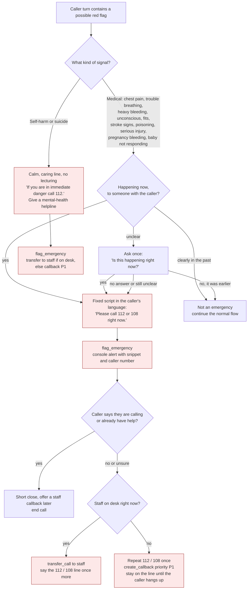
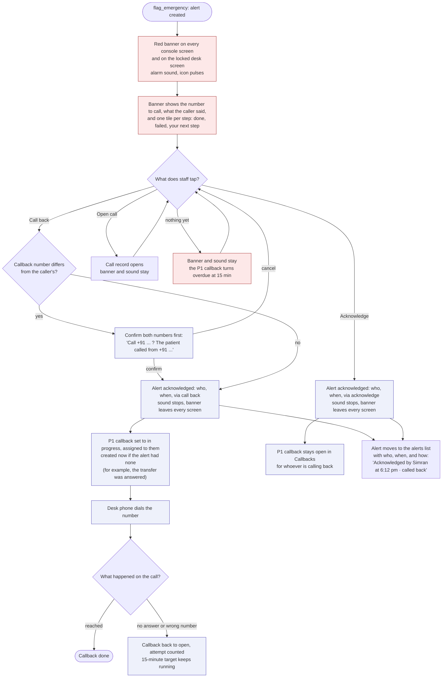
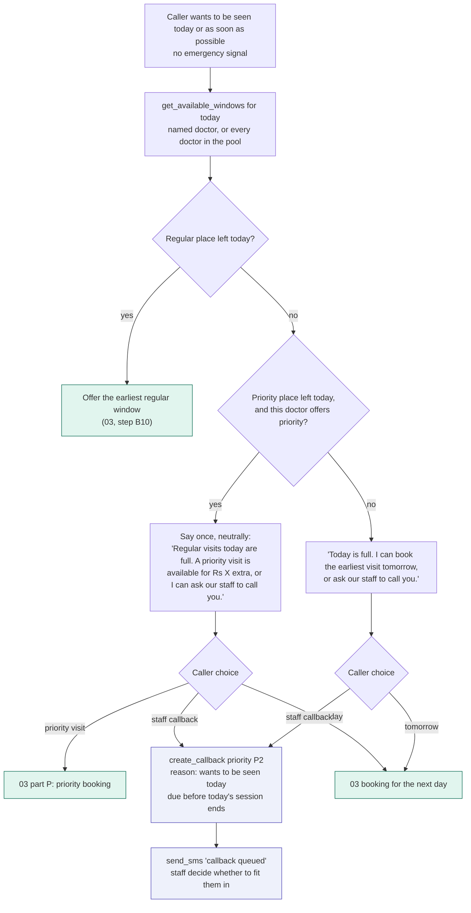
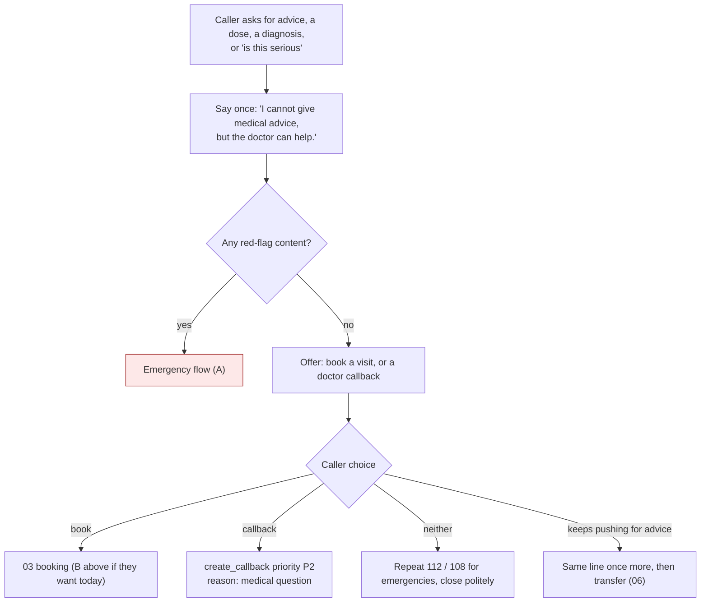

# 01 - Safety and same-day requests

Words matter here, so the terms are fixed:

| Term | Meaning in this project |
|---|---|
| **Emergency** | Someone may be in danger now (heart attack signs, breathing trouble, heavy bleeding...). Never booked. 112 / 108 first. Part A. |
| **Priority visit** | What the clinic calls "urgent": the patient pays an extra fee to be seen before regular patients. A product, not a medical judgement. Booked in 03 part P. |
| **Same-day request** | Caller wants to be seen today but there is no emergency signal. Part B. |
| **Medical advice** | Always declined, then pivoted to a visit or a callback. Part C. |

The agent never says "urgent" to callers. It says "priority visit", so nobody thinks the agent has judged how sick they are.

## A. Emergency and self-harm

Rules:

- The agent never books a visit from an emergency path, never offers a priority visit to someone in an emergency, and never says whether something "sounds serious" or "is probably fine".
- A keyword list is only the minimum. The model also judges intent: "my mother is not waking up" has no keyword and still counts. Tune the whole path to over-trigger rather than miss one.
- Third-person reports count the same as first-person ones.
- Past-tense mentions ("I had chest pain last month, I want a follow-up") are not emergencies, but if the agent cannot tell, it asks once and treats silence as an emergency.
- Test set: build at least 40 phrasings across English, Hindi and Hinglish, with negatives, and require every emergency case to trigger.
- Open item: confirm the helpline numbers to read out before launch (112 national emergency, 108 ambulance in most states, a mental-health helpline such as Tele-MANAS 14416).

## A2. What staff see and do (console)

`flag_emergency` creates the alert. When nobody took the transfer, the agent has also created a P1 callback due in 15 minutes. From there the console takes over:

Rules:

- **Call back also acknowledges.** One tap stops the sound, removes the banner from every screen, and records who, when, and `acknowledged_via = 'call_back'`. Nobody has to tap twice in an emergency.
- **Acknowledge on its own** is for when someone else is already calling, or the caller said help is on the way. It records `acknowledged_via = 'acknowledge'` and leaves the P1 callback open.
- **Different callback number (S-08):** the acknowledgement is recorded only when staff confirm the number. Cancelling the confirm leaves the banner and the sound on.
- **If the call does not connect,** staff mark No answer or Wrong number. The alert stays acknowledged, because someone is on it, but the P1 callback goes back to open with its 15-minute target and turns red when overdue.
- **Nothing else acknowledges:** not Open call, not moving to another screen, not a timeout, not closing the tab.
- **Acknowledged once:** if two people tap at the same moment, the first is recorded and the second sees "Already acknowledged by Simran at 6:12 pm".
- **Any staff role can do it** (S-06): receptionist, cabin assistant, doctor or admin, from the desk PC or a phone.
- A call can still be tagged as a prank afterwards, from the call record (S-16).
- The banner's layout and states live in `design-system/components/EmergencyBanner`.

## B. Same-day request (no emergency signal)

The doctor-defined "urgent criteria" list from the earlier draft is gone. The agent no longer sorts callers by how sick they sound; it only offers what is available.

Rules:

- A priority visit is mentioned only when the caller asks to be seen first, or when regular places on the requested day are full. It is never offered as a reply to symptoms, and it is mentioned once, without pressure.
- If the caller describes symptoms getting worse while talking, the global emergency check (00) runs on that turn, as on every turn.
- Staff can squeeze a same-day caller in from the console. The agent does not promise that they will.

## C. "What should I take?" and other medical advice

