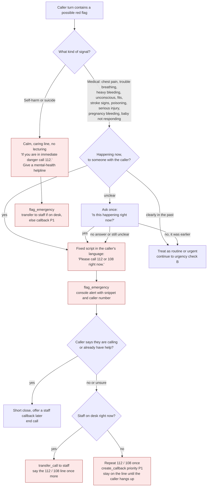
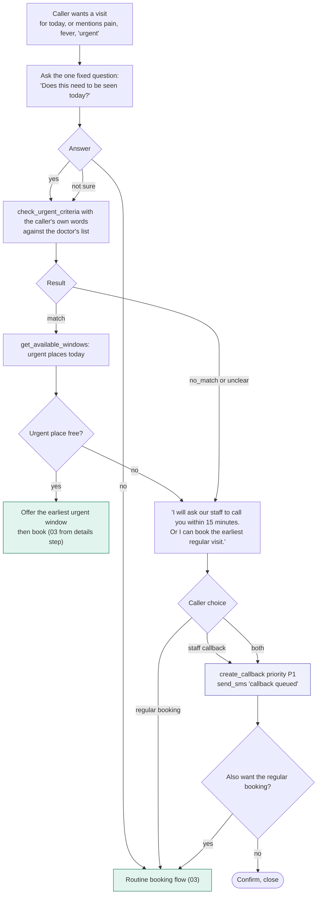
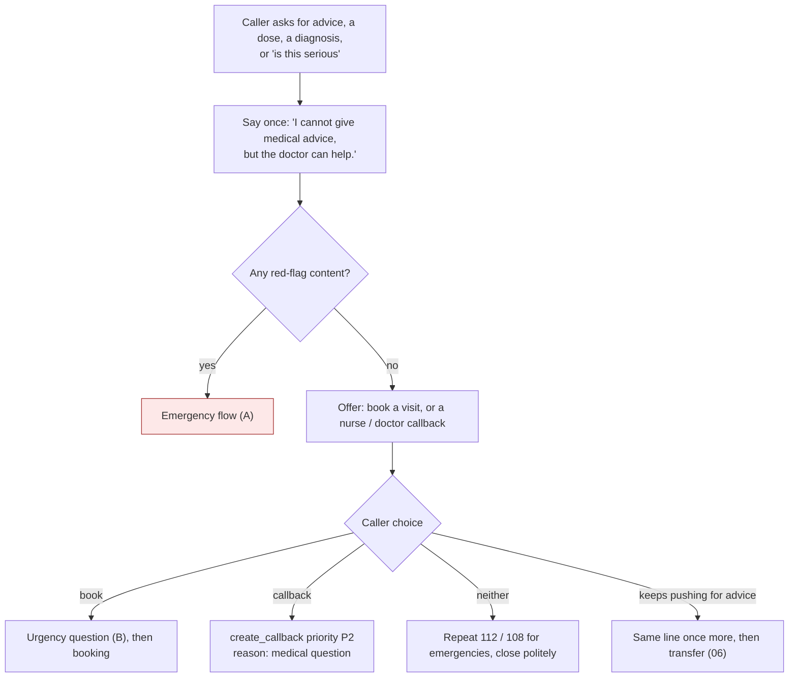

# 01 - Safety and urgency

Three separate things, kept apart on purpose:

1. **Emergency**: someone may be in danger now. Never booked. 112 / 108 first.
2. **Urgent, same day**: wants to be seen today. Handled with the doctor's criteria list or a human, never by the agent's judgement.
3. **Medical advice**: always declined, then pivoted to a visit or a nurse callback.

## A. Emergency and self-harm

Rules:

- The agent never books a visit from an emergency path, and never says whether something "sounds serious" or "is probably fine".
- A keyword list is only the minimum. The model also judges intent: "my mother is not waking up" has no keyword and still counts. Tune the whole path to over-trigger rather than miss one.
- Third-person reports count the same as first-person ones.
- Past-tense mentions ("I had chest pain last month, I want a follow-up") are not emergencies, but if the agent cannot tell, it asks once and treats silence as an emergency.
- Test set: build at least 40 phrasings across English, Hindi and Hinglish, with negatives, and require every emergency case to trigger.
- Open item: confirm the helpline numbers to read out before launch (112 national emergency, 108 ambulance in most states, a mental-health helpline such as Tele-MANAS 14416).

## B. Same-day urgent triage (non-emergency)

Rules:

- The doctor owns the urgent criteria list (default list shipped, edited at onboarding). Examples: fever in a child under 2, pain after a procedure, wound that is bleeding but controlled, a missed critical medicine.
- The agent only compares what the caller said to the list. When the match is unclear, it hands the decision to a person.
- Staff can override any outcome from the console, including turning a routine booking into an urgent one.
- Unused urgent places are released for routine booking before the session (proposed: 2 hours).

## C. "What should I take?" and other medical advice

