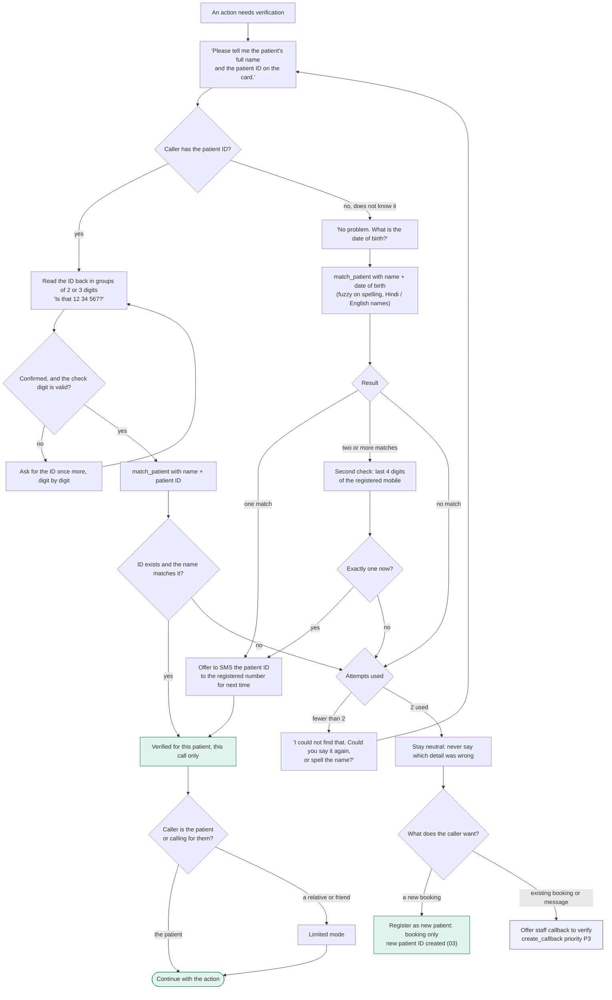

# 02 - Identity verification

Decided: the main check is **name + patient ID** (printed on the patient card). If the caller does not know the ID, **name + date of birth** finds it. Relatives get **limited mode**.

## What needs verification

| Action | Verification | Why |
|---|---|---|
| Hours, address, fees, holidays, doctor schedule | None | Public information |
| "Is Dr X running late today" | None | About the doctor, not a patient |
| Book a new visit | Existing patient: verified. New patient: name, age or date of birth, phone; a patient ID is created | Needs the right file, but reveals nothing |
| View, reschedule or cancel a booking | Verified | Reveals appointment details |
| Message or refill request for the doctor | Verified | Medical context |
| Anything read out about a patient's history | Not in v1 | No access to medical records |

India does not use HIPAA; the equivalent obligations come from the DPDP Act.

## Verification flow

## Rules

- **Patient ID format:** digits only, so it can be spoken in English, Hindi or mixed, with a final check digit. For example, `123456` plus check digit `6` gives `1234566`. The check digit catches most single misheard digits and swapped neighbours before the database is even asked. If the clinic already has IDs with letters or slashes, the system matches on the digits in them and the read-back includes the letters.
- **New patients** get a patient ID the moment the agent creates their record. It goes into the booking SMS, and staff write it on the card at the first visit.
- **The ID is never read aloud** to someone who verified by date of birth. It is sent by SMS to the registered number instead, so it reaches the patient's own phone.
- **Name and ID must agree.** A valid ID with a different name is a failed attempt (it may belong to another family member). The agent does not reveal whose ID it is.
- Verification lasts for this call and this patient. If the caller switches to a different patient (a mother booking for herself, then her son), verify again.
- A shared number is normal. The agent never lists the names linked to a number.
- **Limited mode** (decided): a relative or friend may book, reschedule, cancel and leave a message for the doctor, and hears only the booking details they need. Refill requests from a relative are logged with a "requested by a relative" flag.
- Never confirm or deny that a person is a patient of the clinic to an unverified caller.
- Log every attempt (method, result) in the console for audit.
