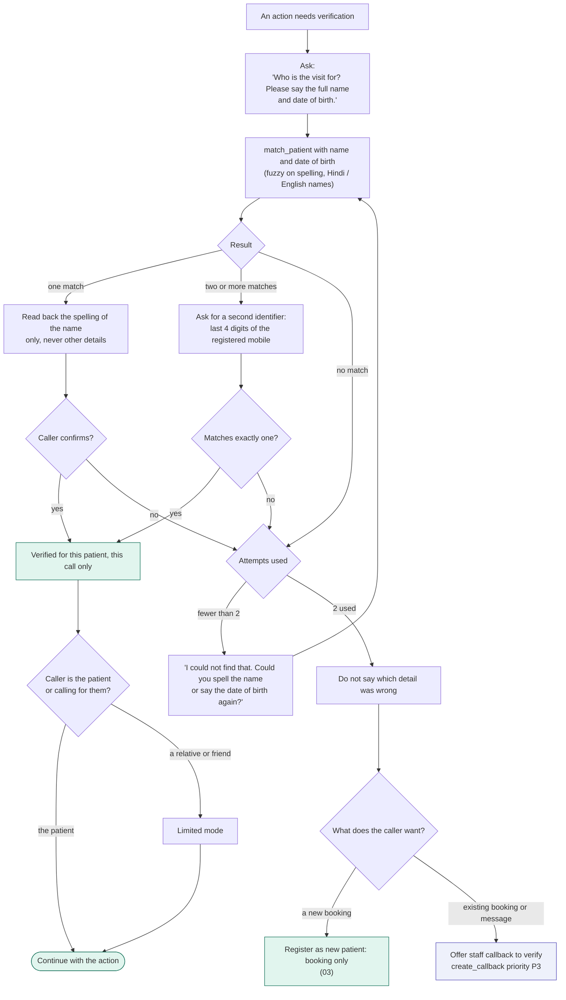

# 02 - Identity verification

## What needs verification

| Action | Verification | Why |
|---|---|---|
| Hours, address, fees, holidays, doctor schedule | None | Public information |
| "Is Dr X running late today" | None | About the doctor, not a patient |
| Book a new visit | Name and phone collected, matched to an existing record if one exists | Needs the right file, but reveals nothing |
| View, reschedule or cancel a booking | Verified patient (two identifiers) | Reveals appointment details |
| Message or refill request for the doctor | Verified patient | Medical context |
| Anything read out about a patient's history | Not in v1 | No access to medical records |

India does not use HIPAA; the equivalent obligations come from the DPDP Act. The two-identifier rule is kept because it works and is easy to explain.

## Verification flow

## Rules

- Verification lasts for this call and this patient. If the caller switches to a different patient (a mother booking for herself, then her son), verify again.
- A shared number is normal. A number linked to several patients is expected, not a warning sign. The agent never lists the names on file.
- Limited mode (caller is not the patient): may book, reschedule, cancel and leave a message for the doctor. May hear only the booking details they need. Refill requests are logged but marked "requested by a relative". This is an assumption to confirm with the clinic.
- Never confirm or deny that a person is a patient of the clinic to an unverified caller.
- After two failed attempts, the agent stays neutral ("I could not match those details") and offers a human, instead of letting the caller keep guessing.
- Name matching is phonetic as well as exact: "Sharma", "Sarma" and the Devanagari spelling should reach the same record. The read-back of the spelling is the safety net.
- Log every verification attempt (success, fail, number) in the console for audit.
