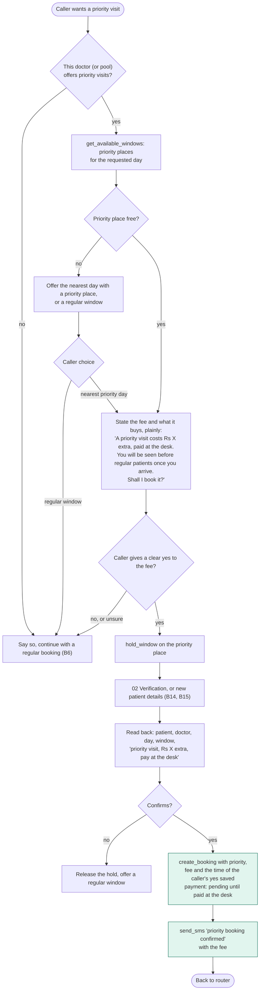

# 03 - Appointment booking (new visit)

Decided:

- **Named-doctor bookings:** the caller chose a doctor by name, or a specialist. The visit stays with that doctor. If the doctor runs late, the patient waits, and the window shifts in time.
- **Any-doctor bookings:** general check-ups and follow-ups where the doctor does not matter. The visit belongs to a pool of doctors. If the assigned doctor is not available, the visit rolls over to another doctor in the pool (A1 to A2).
- **Priority visits:** what the clinic calls "urgent". The patient pays an extra fee to be seen before regular patients (part P).

## Main booking flow

```mermaid
flowchart TD
    B0(["Caller wants to book"]) --> B1{"Clinic open for<br/>the requested day?"}
    B1 -->|"holiday or closed"| B1a["Say so, offer the next open day"]
    B1a --> B2
    B1 -->|"open, or no day given yet"| B2

    B2{"How does the caller pick the doctor?"}
    B2 -->|"by name"| NM["Named-doctor booking<br/>pinned to that doctor"]
    B2 -->|"by specialty, e.g. child specialist"| SP["Offer the specialist with the earliest window<br/>then pinned: named-doctor booking"]
    B2 -->|"general check-up, any doctor is fine"| AD["Any-doctor booking<br/>in the general pool"]
    B2 -->|"follow-up"| FU{"'Same doctor as last time,<br/>or any available doctor?'"}
    FU -->|"same doctor"| NM
    FU -->|"any doctor"| AD
    B2 -->|"only one doctor at the clinic"| NM

    NM --> B5
    SP --> B5
    AD --> B5
    B5{"Asks to be seen first,<br/>or for a priority visit?"}
    B5 -->|"yes"| PR["Part P: priority booking"]
    B5 -->|"no"| B6

    B6["Ask preferred day and time of day<br/>understand 'kal', 'parso', 'Monday', 'this week'"]
    B6 --> B7{"This person already booked<br/>with the same doctor that day?"}
    B7 -->|"yes"| B7a["Offer to reschedule that one instead (04)"]
    B7 -->|"no"| B8

    B8["get_available_windows<br/>named: that doctor; any: every pool doctor, earliest first"]
    B8 --> B9{"Regular windows on the<br/>requested day?"}
    B9 -->|"yes"| B10
    B9 -->|"no"| B9a{"Windows in the<br/>next 7 days?"}
    B9a -->|"yes"| B9b["Offer the 2 nearest, say the day<br/>if today is full: 01 part B"]
    B9b --> B10
    B9a -->|"no"| W["Offer the waitlist or a staff callback<br/>create_callback priority P3"]

    B10["Offer at most 2 windows<br/>'Monday, between 10 and 10:30, or 11 to 11:30?'<br/>any-doctor: 'currently with Dr A1'"]
    B10 --> B11{"Caller reply"}
    B11 -->|"takes one"| B12
    B11 -->|"wants other time or day"| B11a{"Rounds used"}
    B11a -->|"fewer than 3"| B6
    B11a -->|"3 used"| W
    B11 -->|"no thanks"| B11b(["Close politely, offer to call back"])

    B12["hold_window for 90 s"] --> B13{"Hold granted?"}
    B13 -->|"no, just taken"| B13a["'That one was just taken.'"]
    B13a --> B8
    B13 -->|"yes"| B14

    B14{"Patient already known?"}
    B14 -->|"yes"| V["02 Verification<br/>name + patient ID, or name + date of birth"]
    B14 -->|"new patient"| B15["Collect: full name, age or date of birth,<br/>confirm the phone number<br/>nothing medical; patient ID created"]
    V --> B16
    B15 --> B16

    B16["Read back: patient name, doctor,<br/>day and date, arrival window"]
    B16 --> B17{"Caller confirms?"}
    B17 -->|"yes"| B18["create_booking"]
    B17 -->|"fix something"| B17a["Correct the detail, read back again"]
    B17a --> B16
    B17 -->|"cancel"| REL["Release the hold"]
    REL --> B11b

    B18 --> B19{"Result"}
    B19 -->|"ok"| B20["send_sms 'booking confirmed'<br/>new patients: includes the patient ID<br/>calendar mirror updated in the background"]
    B19 -->|"conflict"| B19a["Hold lost, re-offer (back to B8)"]
    B19 -->|"error"| B19b["'I could not complete that right now.'<br/>create_callback priority P2, confirm callback"]
    B20 --> B21{"Booking type"}
    B21 -->|"named doctor"| B21a["'Come any time in the window. If the doctor is running late<br/>you may have to wait; we text you if it is over 20 minutes.'"]
    B21 -->|"any doctor"| B21b["'Come any time in the window. If Dr A1 is not available,<br/>we move you to another doctor and text you.'"]
    B21a --> B22(["Back to router: anything else?"])
    B21b --> B22

    classDef agent fill:#e1f5ee,stroke:#0f6e56;
    classDef human fill:#eef1fb,stroke:#534ab7;
    class B18,B20,B21a,B21b agent;
    class W,B19b human;
```

## Part P: priority booking

## Rules

- The agent offers a window, never a promised clock time. It explains a window once, in plain words: "come any time in this half hour; patients are seen in the order they arrive."
- **Named-doctor:** never moved to another doctor by the system. If the doctor runs late, later windows shift and the patient waits (delay rules in 09). If the patient cannot be seen today, the visit moves to the same doctor's next available window.
- **Any-doctor:** the agent books the earliest window across the pool and says which doctor it is "currently" with. On the day, the visit can move to another pool doctor (see 09). The patient is told by SMS whenever the doctor changes.
- **Follow-ups:** the agent asks once whether the caller wants the same doctor as last time. The last doctor comes from booking history, not from medical records.
- **Specialty requests** are pinned to the doctor offered at booking, as decided. Open question: should two doctors of the same specialty form a pool?
- **Priority visits:**
  - The fee is read out before booking, and the booking needs a clear "yes" to that fee. The time of the "yes" and the call ID are stored.
  - Payment is at the desk in the demo (status "pending" until staff mark it paid). A UPI link by SMS is a later option.
  - Priority patients are seen before regular patients who have already arrived, in their own arrival order.
  - Priority places are reserved per window (default 1). Unsold places go back to regular booking before the session (proposed: 2 hours).
  - The system never moves a priority visit to another day by itself. Staff decide (09).
- Maximum two options per offer, maximum three offer rounds. After that, a person takes over.
- Same-day routine bookings are only offered for windows that start at least 30 minutes from now (proposed).
- A hold lasts 90 seconds (proposed). If the caller hangs up during the hold, the window is released and the console logs an "abandoned booking".
- The booking writes to Postgres first, and a database check on each window stops overbooking. The Google Calendar mirror follows; if it fails, the booking still stands (08).
- No medical details are collected for a booking. The visit type and, at most, a short reason category go into the record.
