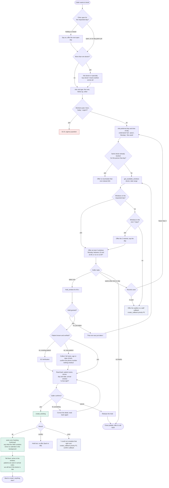

# 03 - Appointment booking (new visit)

## Rules

- The agent offers a window, never a promised clock time. It says what a window means once, in plain words: "come any time in this half hour; patients are seen in the order they arrive."
- Maximum two options per offer, maximum three offer rounds. After that, a person takes over; endless back-and-forth wastes the caller's time.
- Same-day routine bookings are only offered for windows that start at least 30 minutes from now (proposed).
- A hold lasts 90 seconds (proposed). If the caller hangs up during the hold, the window is released and the console logs an "abandoned booking" with the number, so staff can call back if they wish.
- The booking writes to Postgres first, and the database constraint on windows stops double-booking. The Google Calendar mirror runs afterwards; if the calendar call fails, the booking still stands and the mirror retries (see 08).
- No medical details are collected for a booking. The visit type and, at most, a short reason category go into the record.
- Read-back always uses the spoken date form, and reads the arrival window as a range.
- A doctor on leave, in the middle of a delay flagged as 60+ minutes, or with a cancelled session does not appear in the window results at all.
