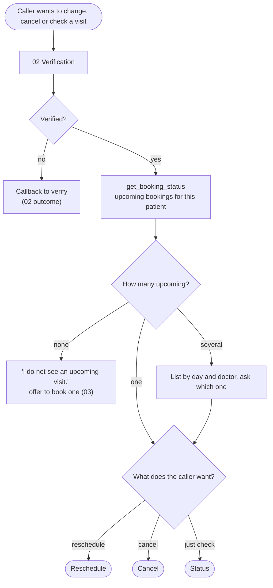
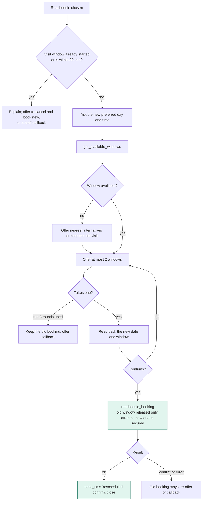
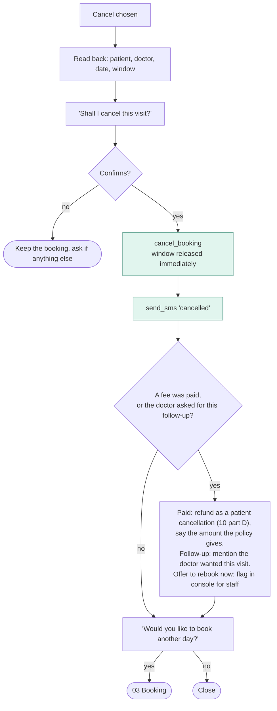
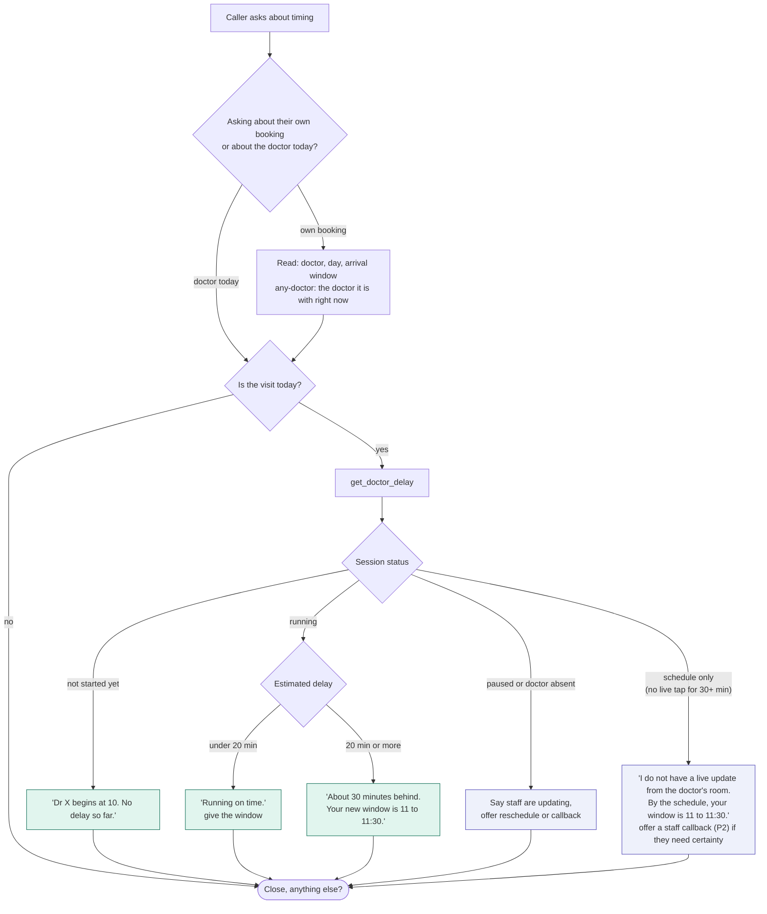

# 04 - Reschedule, cancel, booking status, doctor delay

## Find the booking first

## Reschedule

## Cancel

Cancelling is never made hard: no penalty talk, no pressure. Late cancellations are only noted for the clinic's records.

## Status and "is the doctor running late"

Rules:

- The doctor's delay is public and needs no verification; only the caller's own booking details do.
- The agent states an estimate as an estimate ("about 30 minutes"), never a promise.
- When the estimate is schedule-only (nobody has tapped "Call next" for 30 minutes), the agent says it has no live update instead of claiming the doctor is on time. A wrong delay answer is worse than none.
- If the system has already moved the visit (delay cap or doctor absent, see 09), the agent reads the new window and doctor, and offers to change it.
- Priority visits are rescheduled like any other visit when the caller asks; the fee carries over to the new date.
