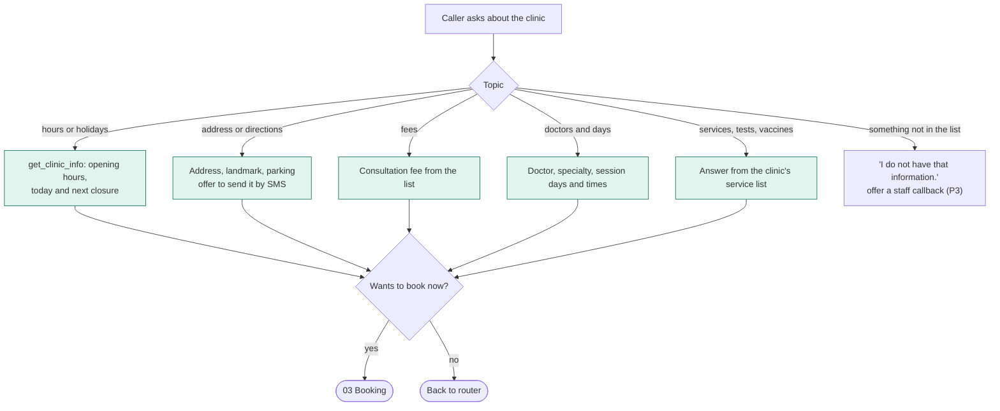
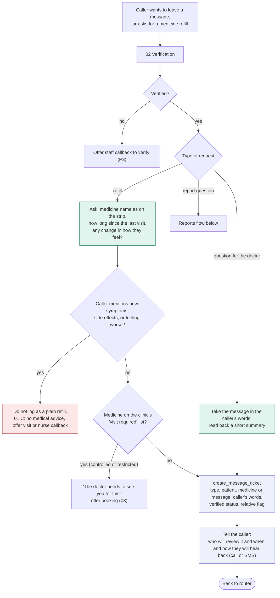
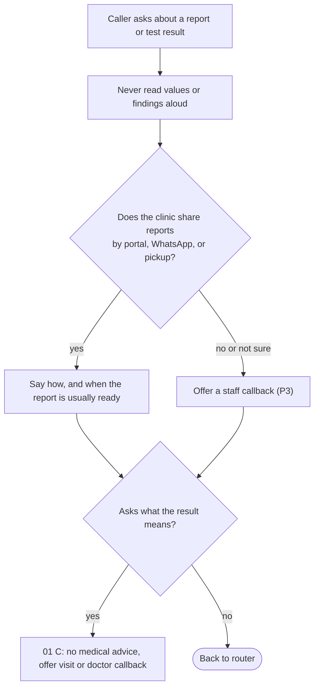
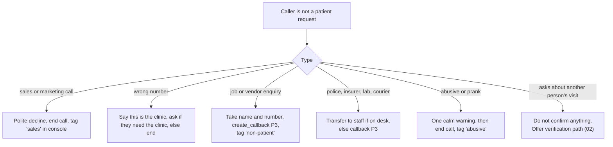

# 05 - Clinic info, messages, and out-of-scope requests

## Clinic information

Answers come only from the clinic's own information (knowledge base and `get_clinic_info`). If it is not there, the agent says it does not know and never guesses, especially on fees and test availability.

## Message or refill request for the doctor

Rules:

- The agent cannot approve a refill. It records the request; the doctor decides in the console.
- Every ticket tells the caller a realistic reply time. If the clinic has not set one, the default is "within the next working session".
- The pharmacy question from the US draft is dropped; Indian refills are normally collected from any pharmacy. Add it back if a partner clinic wants it.
- A refill request from a relative is logged with a "requested by a relative" flag so the doctor can decide whether to contact the patient directly.

## Reports and lab results

## Billing and payment questions

Billing disputes, payment plans, refunds and insurance claims go to a human: transfer when staff are on desk, otherwise a callback (06). Simple facts such as the consultation fee are answered by the info flow above.

## Out-of-scope calls

