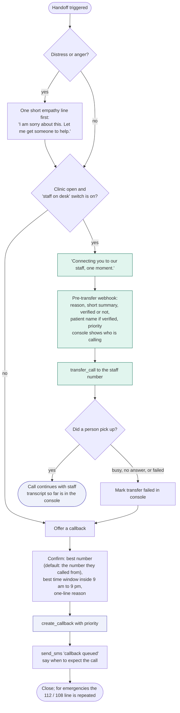

# 06 - Human handoff and callbacks

A small clinic often has nobody free exactly when the agent needs a person. So every handoff has a fallback that ends in a logged callback, never a dead end.

## Triggers

| Trigger | Where it fires |
|---|---|
| Caller asks for a person ("operator", "agent", "speak to someone", "receptionist", Hindi equivalents) | Any turn |
| Not understood twice in a row | Any turn |
| Distress or anger (says they are upset, repeats the same request 3 times, swears, shouts) | Any turn |
| Billing dispute, payment plan, complaint | Intent routing |
| Offer rounds used up in booking | 03, 04 |
| Caller keeps pushing for medical advice | 01 C |
| Tool or backend failure that blocks the request | 03, 04, 05, 08 |
| Emergency, no one with the caller | 01 A (uses the same transfer step) |

## Decision tree

## Priorities and targets (proposed)

| Priority | When | Target |
|---|---|---|
| P1 | Emergency flagged, self-harm | Staff call within 15 minutes, console alert with sound. Tapping Call back on the alert also acknowledges it and puts this callback in progress (01 A2) |
| P2 | Wants to be seen today and nothing is free; distress or anger; medical question; tool failure on a booking; transfer failed | Within 2 hours, and before today's session ends for same-day requests |
| P3 | Messages, refills, reports, billing, verification, non-patient | Next working session, same day if before 6 pm |

## Rules

- The pre-transfer webhook is fire-and-forget, so a slow console never delays the transfer. Fields known only at call end (full transcript, cost, summary) are not in it.
- Bolna's documentation does not say what happens when the destination does not answer. Test this on the real telephony setup before the demo. If the transfer cannot be detected as failed, the post-call webhook creates the callback automatically for any call tagged "transfer requested" that ended with no human conversation.
- After hours, the agent does not pretend someone will answer. It says when the clinic opens and when the callback will happen.
- The caller is never told "I cannot help you" without an alternative: transfer, callback, or SMS.
- **Callback numbers** (security review S-08): the default is the number the caller rang from. If the caller asks for a different number, the agent reads it back, the callback is marked "different from caller", and staff confirm before dialling. Only Indian numbers are accepted. International or premium-rate numbers are refused politely.
- The console callback queue is sorted by priority, then by waiting time. Each item shows reason, caller number, verified status, language, and the transcript.
- A callback is closed by staff with an outcome (reached, no answer, wrong number). No answer after two attempts creates an SMS and leaves the item open.
