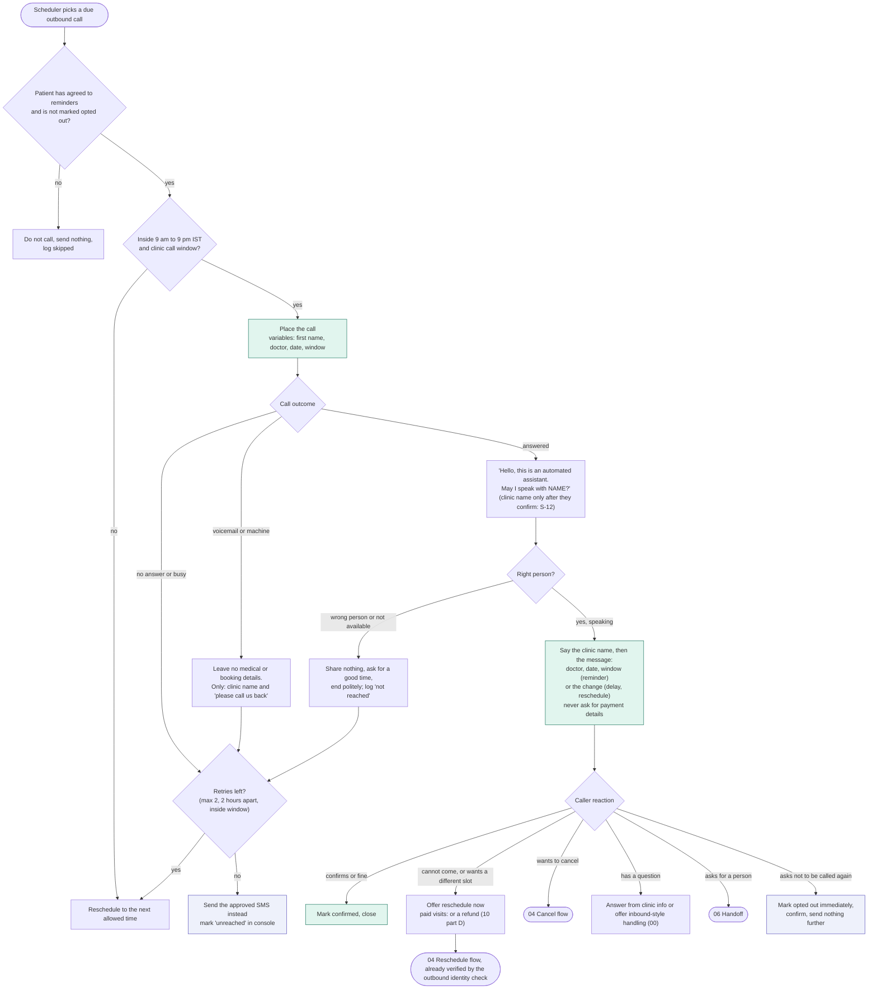

# 07 - Outbound calls

## What gets called

| Call | Trigger | Default timing |
|---|---|---|
| Reminder | Booking exists | Evening before, inside the call window (and a morning SMS) |
| Delay update | Estimated delay passes the threshold | When the shift is decided (SMS first; call only if the patient is within an hour of leaving) |
| Delay choice | Two delay messages already sent and the doctor is still slipping (09 D10) | Straight away: keep the place, move to the next free slot, or cancel |
| Reschedule offer | Doctor absent or session cancelled (09 X5), or staff ask | Straight away; patient picks a slot or asks for a refund (10) |
| Payment follow-up | Caller chose UPI on the call (10 part B) | WhatsApp message with the link, not a call; one reminder |
| Doctor changed | An any-doctor visit moved to another pool doctor | SMS only; a call only if it is less than an hour before the window |
| Callback result | Staff resolved a message or question | After staff mark it ready |
| Refill outcome | The patient's own doctor decided a refill (11) | SMS only, to the registered number, no medicine name. The agent never calls with a refill outcome |
| Follow-up reminder | Doctor set a follow-up date at checkout | Evening before |

In the demo, outbound calls go only to numbers the team controls.

## Decision tree

## Rules

- Identity before content: the agent says nothing about a visit until the person says they are the patient (or the number's registered contact for that patient).
- No health information on voicemail or to a wrong person, ever. The message contains no reason for the visit.
- The agent opens by saying it is automated, same as inbound.
- Calling hours are enforced twice: Bolna's calling guardrails (9 am to 9 pm IST) and the scheduler. A caller's requested callback time outside the window is rejected, not rounded.
- Compliance for production: reminders to patients are service calls; they are expected to need a 160-series number registered through DLT, and a consent line captured at booking ("May we remind you by call and SMS?"). Not needed for the demo.
- Every outbound call writes the same webhook data as an inbound one, tagged with its reason, so the console shows one timeline per patient.
