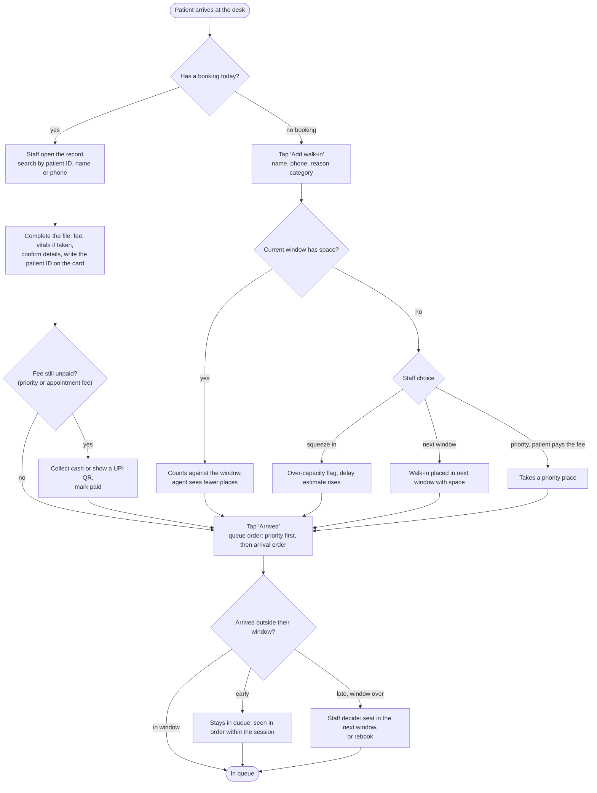
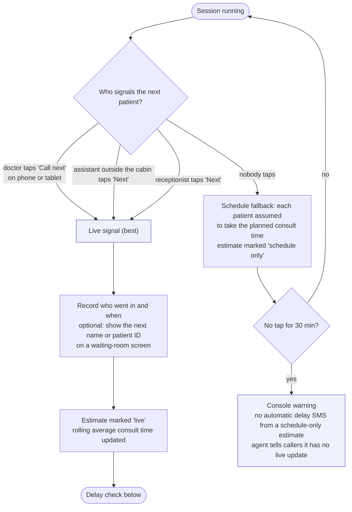
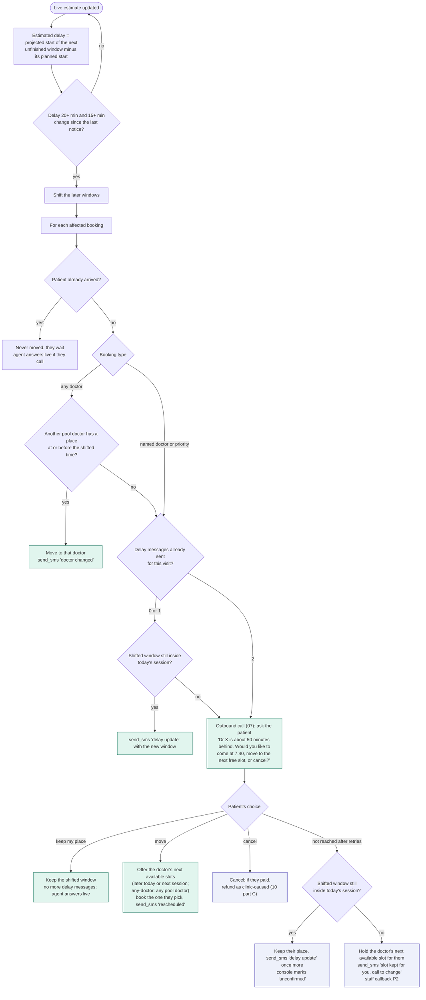
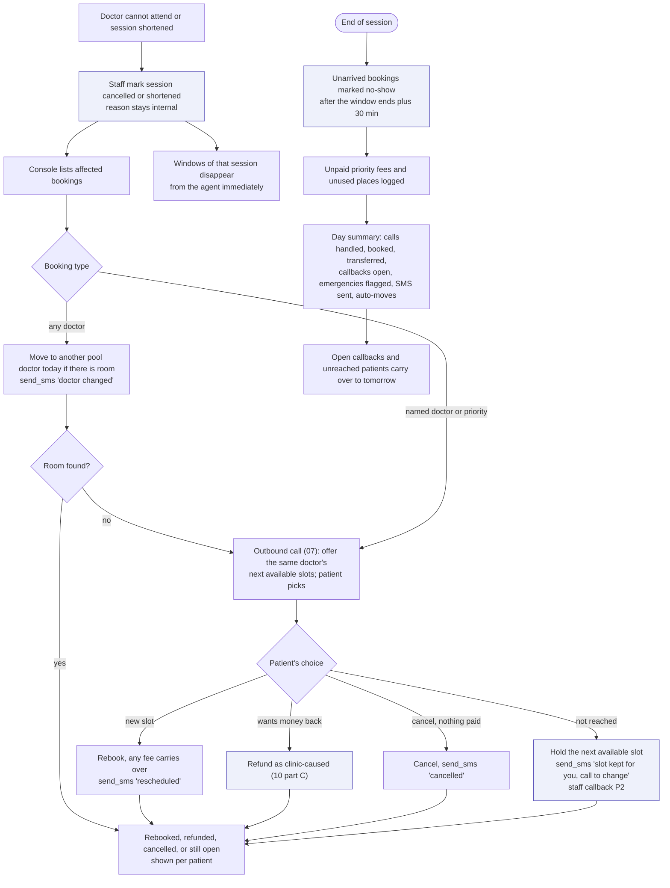

# 09 - Day-of operations (console side)

Decided:

- **"Next patient" is hybrid.** The system assumes the planned schedule by default. The doctor (from a phone or tablet in the cabin) or an assistant outside the cabin taps "Call next" to correct it with real timing.
- **Delay messages stop at 2.** After that, the agent calls and asks the patient what they want: keep their place and come later, move to the doctor's next available slot, or cancel (with a refund if they paid).
- **Patients who have arrived wait.** The system never moves them.
- **Any-doctor visits roll over** to another pool doctor when the assigned doctor is absent or running late.

## Patient arrives

## The "next patient" signal (hybrid)

The "Call next" button should do something the doctor already needs, such as calling the next patient in by name or number on a screen. A clinic bell gives the system nothing. A button that replaces the bell gives it real timing for free.

## Delay check and what happens to each booking

## Doctor absent, session changes, end of day

## Console screens this implies

| Screen | Main contents |
|---|---|
| Live queue | Today's windows, who has arrived (priority marked), who is with the doctor, "Call next" button, delay estimate with "live" or "schedule only" |
| Doctor view | Single big "Call next" button and the next patient's name or ID; works on a phone |
| Bookings | Calendar-style view by doctor and window; named vs any-doctor; create, move, cancel; payment status |
| Payments and refunds | UPI links sent, paid, expired; cash collected; refund requests to approve, change or reject |
| Callbacks | Priority-sorted queue with transcript snippet, caller number, reason, verification status |
| Messages and refills | Tickets for the doctor to approve or answer |
| Emergency alerts | Red banner on every screen until someone acknowledges it; Call back also acknowledges (01 A2). The alerts list shows who, when, and whether they called back |
| Calls | Every call with transcript, language, tags, outcome, recording link |
| SMS outbox | Sent and failed messages, template used |
| Settings | Windows, capacity, priority places, priority and appointment fees per doctor, payment and refund rules, release time, doctor pools, staff-on-desk switch, clinic info, thresholds |
