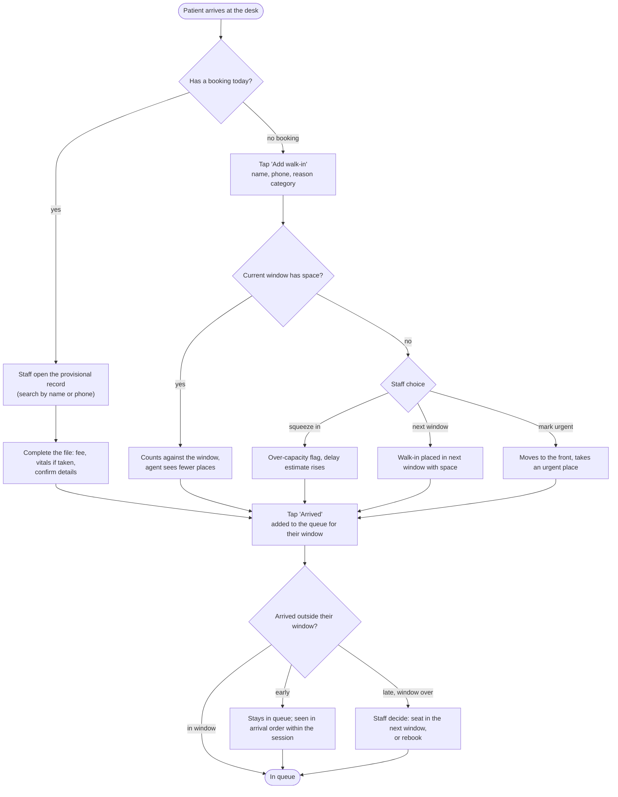
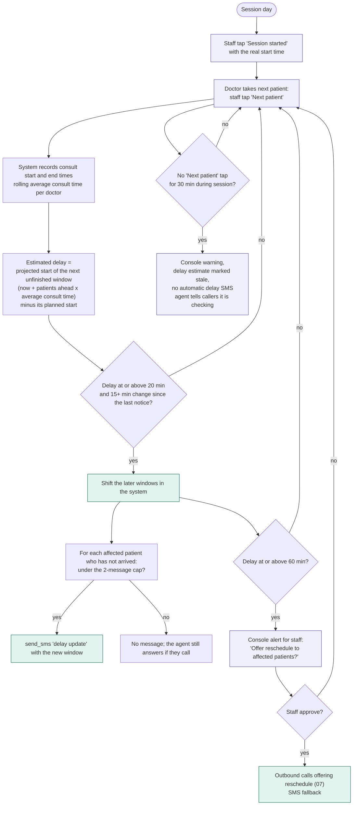
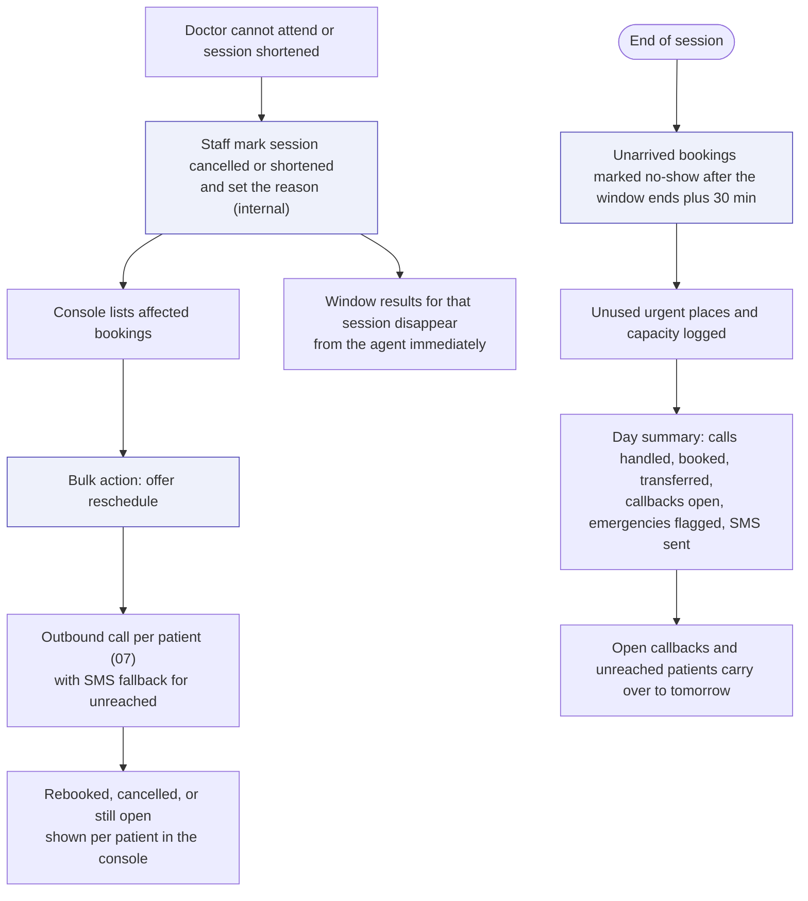

# 09 - Day-of operations (console side)

This is where arrival windows become real: someone has to tell the system when patients arrive and when the doctor takes the next one. The agent depends on it for every delay answer.

## Patient arrives

## Doctor's session and delay updates

## Doctor absent, session changes, end of day

## Console screens this implies

| Screen | Main contents |
|---|---|
| Live queue | Today's windows, who has arrived, who is with the doctor, "Next patient" button, delay estimate |
| Bookings | Calendar-style view by doctor and window; create, move, cancel; provisional vs completed files |
| Callbacks | Priority-sorted queue with transcript snippet, caller number, reason, verification status |
| Messages and refills | Tickets for the doctor to approve or answer |
| Emergency alerts | Latest flags, with a clear acknowledge action |
| Calls | Every call with transcript, language, tags, outcome, recording link |
| SMS outbox | Sent and failed messages, template used |
| Settings | Windows, capacity, urgent places and release time, urgent criteria list, staff-on-desk switch, clinic info, thresholds |
