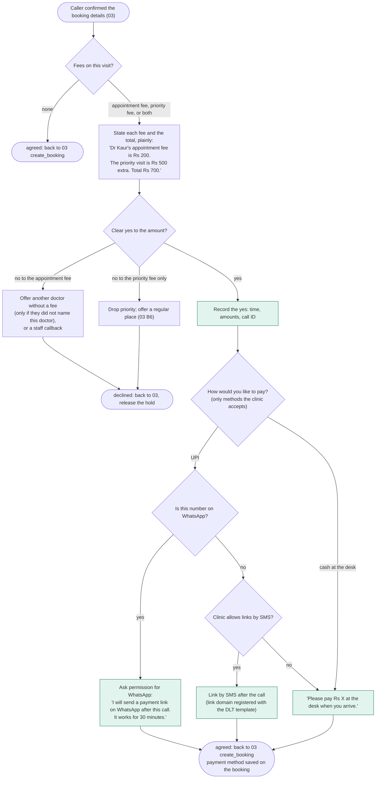
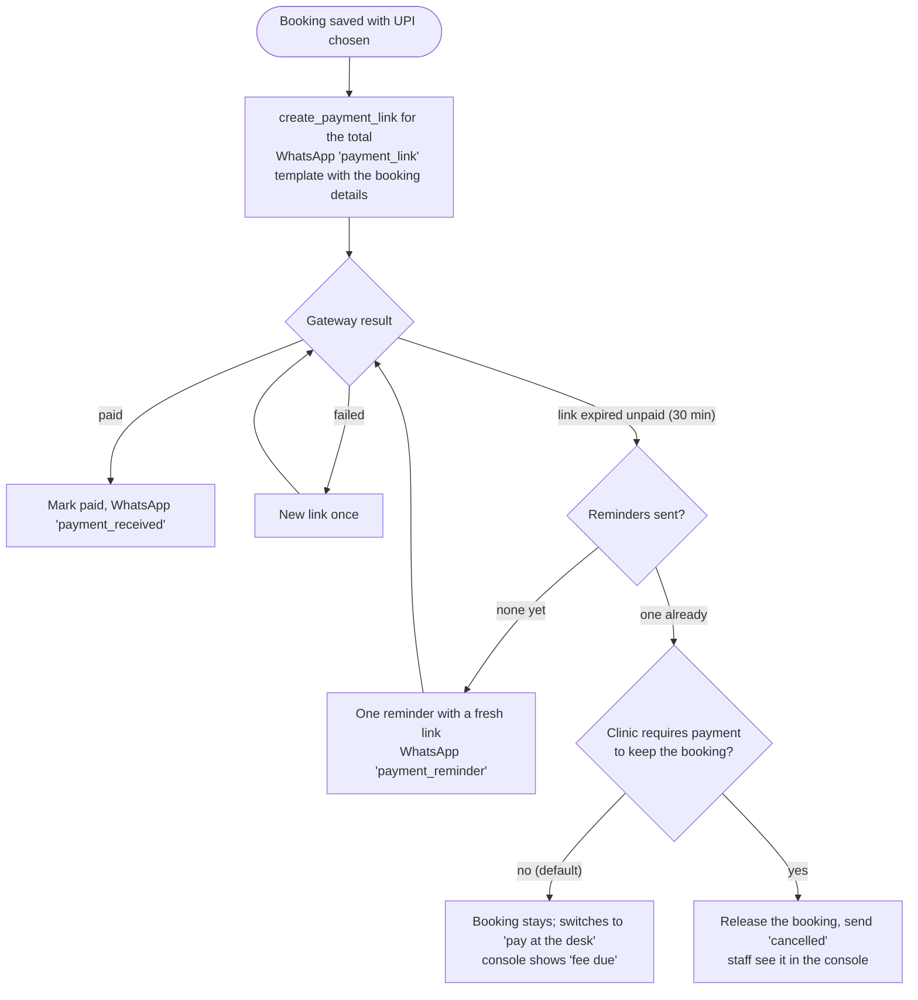
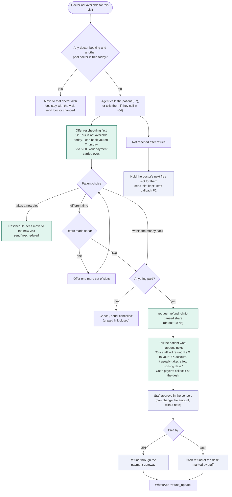
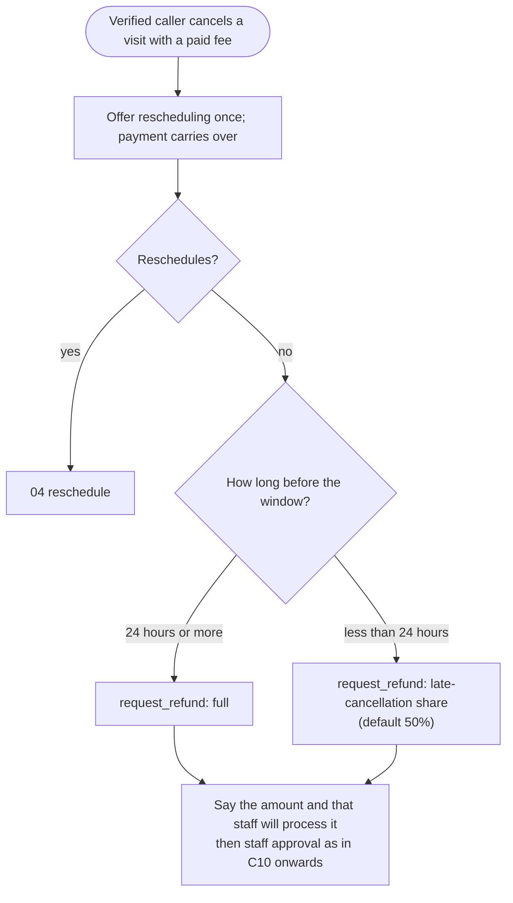

# 10 - Fees, payments and refunds

Decided:

- **Priority visits** are offered for **specialists and super-specialists** only.
- The clinic can also set a **required appointment fee** per doctor.
- Patients pay by **UPI link sent on WhatsApp after the call**, or in **cash at the desk**. The clinic chooses which methods it accepts.
- **If the doctor is not available**, the agent first offers rescheduling. If the patient still wants their money back, a **partial or full refund** is processed by the clinic's rule.

The agent never moves money. It explains fees, records the patient's agreement, triggers the payment link, and raises refund requests. Staff approve refunds in the console (setting `refund_needs_approval`, on by default).

## A. Fees at booking (called from 03 after the caller confirms the read-back, B17f and P5)

## B. After the call: payment link follow-up

## C. Doctor not available (parallel tree, clinic-caused)

Starts when the doctor is absent or the session is cancelled (09 X5). It also starts when the patient cancels after the delay-choice call (09 D14). It runs for every affected booking; the refund branch only exists if something was paid.

## D. Patient cancels a paid visit (04)

No-shows get no refund request. Staff can still grant a goodwill refund from the console.

## Rules

- **Fees are read out before booking**, with the total, and the booking needs a clear yes to that amount. The time, the amounts and the call ID are stored. The database refuses an agent booking with a fee but no recorded yes or no payment method.
- **WhatsApp needs permission.** The agent asks before sending anything on WhatsApp, and the answer is stored as consent. WhatsApp business messages use pre-approved templates (utility category), separate from SMS DLT templates.
- **Links go only to the number on the booking**, never to a number read out on the call, and never in a voicemail.
- **One reminder** for an unpaid link. After that, the fee is collected at the desk, unless the clinic requires payment to keep the booking.
- **Rescheduling is offered at most twice** before a refund. Once the patient asks for the money back, the agent stops offering.
- **The agent never says a refund is done.** It says a request has been raised, gives the clinic's usual timeline, and staff approve. The database refuses refunds that would add up to more than was paid.
- **Refund rules** (proposed values, clinic to confirm; all are settings):

  | Reason | Default |
  |---|---|
  | Doctor absent, session cancelled, or patient cancels after the delay-choice call | Full refund |
  | Patient cancels 24+ hours before | Full refund |
  | Patient cancels within 24 hours | 50% |
  | No-show | None (staff may grant goodwill) |

  Keeping part of the fee when the clinic itself cancelled is likely to cause complaints, and may not be allowed under India's consumer protection rules. The clinic should get that checked.
- **Demo:** payment gateway in test mode and WhatsApp messages shown in the console outbox, as with SMS. No real money moves.
