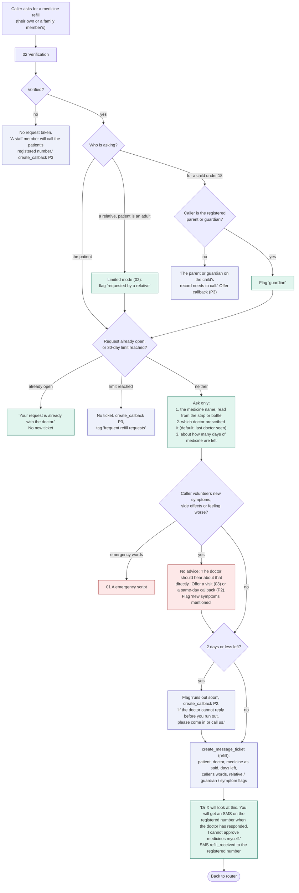
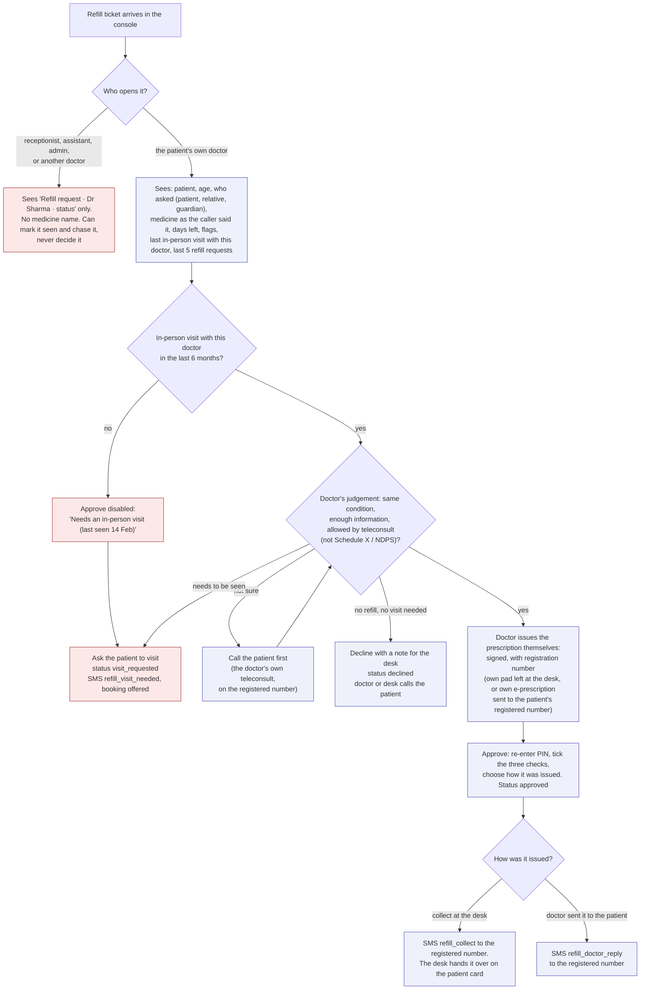

# 11 - Prescription refills

**Rule (Oct 2026):** only the patient's own doctor decides a refill. The agent takes the request and nothing more: it never screens, advises, approves or hints at the outcome. Bolnai never writes, stores or sends a prescription; the doctor issues it.

This replaces the refill part of `05`, where the agent asked how the patient felt and checked a "visit required" medicine list. That put the AI in a clinical role, the list missed brand names, and any desk user could mark a refill approved (security review S-20).

## Why: the rules this follows

Not legal advice; the clinic's doctors and advisor should confirm.

| Rule (India) | What it means here |
|---|---|
| AI and machine-learning platforms "cannot counsel or prescribe any medicine"; AI may support the doctor, who makes the final decision (Telemedicine Practice Guidelines 2020) | The agent asks no clinical questions and makes no medicine judgement. It never says a medicine needs a visit, is fine, or is approved |
| A refill without a visit is the doctor's **follow-up teleconsultation**: the same doctor, within **6 months** of an in-person consultation, for the same condition. A different condition counts as a first consult; after 6 months an in-person visit is needed | The console shows the last in-person visit with that doctor. The database refuses an approval without a completed visit with the same doctor in the last 180 days |
| Phone, audio or text follow-ups can renew medicines already started in person. The prohibited list (**Schedule X** and **NDPS** narcotic and psychotropic drugs) can never be prescribed by teleconsultation. Tramadol has been an NDPS psychotropic since 2018; benzodiazepines such as chlordiazepoxide are NDPS psychotropics too | The doctor confirms "not Schedule X / NDPS" before approving. These go to "Ask the patient to visit" |
| The doctor prescribes only with enough information; if an examination is needed, the teleconsult stops and the patient is seen in person | "Call the patient first" and "Ask the patient to visit" are always available to the doctor |
| The prescription carries the doctor's registration number and signature (a digital signature is allowed). The patient gets a copy; it goes to a pharmacy only with the patient's explicit consent | The doctor issues it from their own pad or e-prescription. Bolnai's SMS only says the doctor has responded, and states that it is not a prescription. No pharmacy routing in v1 |
| Teleconsultation for a minor needs an identified adult | A child's refill is taken only from a registered parent or guardian (enforced in the database) |
| Signing credentials stay with the doctor and are never shared or delegated (NMC advisory, 13 Oct 2026, on remote authentication of records; the same principle applies here) | Each doctor uses their own account, re-enters a PIN to approve, and nobody else can decide a refill. A shared desk login can never approve |
| Controlled lists change: an August 2026 draft moves zopiclone, gabapentin, carisoprodol and flupentixol into Schedule H1 | No hard-coded medicine list anywhere in the agent |

## A. Agent: taking the request

## B. Doctor: deciding in the console

## Who can do what

| Action | Agent | Receptionist | Cabin assistant | Patient's own doctor | Other doctor | Admin |
|---|---|---|---|---|---|---|
| Take a refill request | yes (verified caller) | yes | no | yes | no | yes |
| See the medicine name | the caller's own words only, during the call | no | no | yes | no | no |
| Mark seen, chase, call the patient back | no | yes | no | yes | no | yes |
| Approve, decline, ask to visit | **never** | no | no | **yes** | no | no |
| Change the medicine or the caller's words | no | no | no | no | no | no |

The database enforces the last two rows and the doctor-only decision (`db/schema.sql`, `enforce_refill_rules`). The console and API must also enforce the rest (S-06, S-20).

## Rules

- **The agent is a note-taker here.** It asks the three practical questions and nothing clinical. It does not suggest alternatives, over-the-counter medicines or doses, and it never says "approved", "should be fine" or "ready by". It may read back the medicine name the caller just said, to confirm spelling; it never volunteers a medicine name from any record.
- **No list in the agent.** Whether a medicine can be renewed without a visit is the doctor's decision. A list in the agent goes stale, misses brand names, and tells drug-seekers which words to avoid.
- **The doctor's checks are recorded.** An approval stores who decided, when, the last in-person visit date, the three confirmations (same condition, enough information, not Schedule X / NDPS) and how the prescription was issued. The database refuses an approval missing any of them.
- **Messages carry no medicine names** and always go to the patient's registered number, never a number given on the call. Every refill SMS says the doctor has responded; the received SMS says it is not a prescription.
- **Desk handover:** a prescription left at the desk is handed over against the patient card and a name check. A relative collecting it needs the card.
- **Running out:** 2 days or less left (setting) makes a same-day P2 callback, so a patient on insulin or seizure medicine is not left waiting until the next session. The agent still gives no advice; the 112 / 108 line applies as always.
- **Abuse signals shown to the doctor:** requests from relatives, unverified lines, repeat or early requests (last 5 requests listed), and the caller's own words, labelled "Caller said". A line like "the doctor already said yes" is just text: it never changes a status.
- **Limits:** one open refill request per patient, at most 4 per 30 days (setting); beyond that, a staff callback.
- **Approvals need the doctor present:** a PIN re-entry on approve, short sessions and remote sign-out on doctor phones (S-06), so a lost phone cannot approve refills.
- **Not in v1:** sending prescriptions to pharmacies (would need the patient's explicit consent and their choice of pharmacy), storing prescriptions, generating e-prescriptions, and tracking quantities for early-refill alerts.

## Sources

- Telemedicine Practice Guidelines 2020 summaries: [MediaNama](https://www.medianama.com/2020/03/223-summary-india-telemedicine-guidelines/), [PSA Legal FAQ](https://psalegal.com/telemedicine-guidelines-2020-faq/), [AIIMS telemedicine FAQ](https://aiims.edu/images/pdf/notice/FAQ_Telemedicine.pdf), [Khaitan & Co](https://www.khaitanco.com/sites/default/files/2021-08/Ergo_31032020.pdf), [Mondaq](https://www.mondaq.com/india/healthcare/915292/legal-and-regulatory-framework-for-digital-health-telemedicine-practice-guidelines)
- Tramadol under NDPS (2018): [Mondaq](https://mondaq.com/india/food-and-drugs-law/701838/government-declares-tramadol-a-psychotropic-substance-to-curb-its-abuse-and-trafficking)
- Chlordiazepoxide as an NDPS psychotropic, and pharmacy record duties: [Punjab and Haryana High Court, CWP-26127-2026](https://www.livelaw.in/pdf_upload/2026/09/02/18-697567.pdf)
- Draft Schedule H1 additions (Aug 2026): [Medical Dialogues](https://medicaldialogues.in/amp/news/industry/pharma/health-ministry-proposes-tighter-prescription-monitoring-for-4-cns-drugs-178041)
- NMC advisory on remote authentication (13 Oct 2026): [Medical Dialogues](https://medicaldialogues.in/health-news/nmc/nmc-issues-advisory-for-doctors-on-remote-authentication-of-medical-records-via-digital-signatures-181173)
