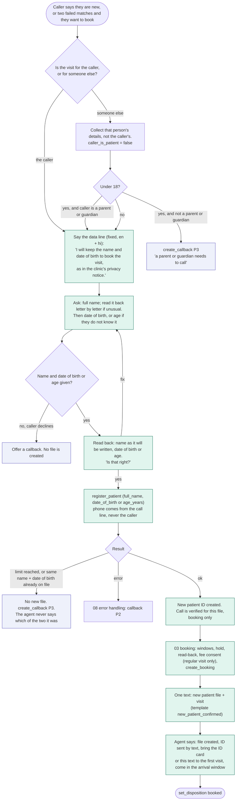

# 12. New patient calls

A caller who has no file at the clinic phones to book a first visit. This flow covers what the agent asks, when a file is created, which limits apply, and what the patient gets by text. Decisions D-37 to D-40 in `docs/decision-log.md` (29 Oct rules D-11 and D-16 still apply). Booking itself is `03`; verification of existing patients is `02`.

## Scope in one paragraph

A new patient can do one thing on the first call: book a regular visit. The agent asks for a full name, a date of birth or age, and nothing medical. The phone number is the one the call came from. When the file exists the agent books the visit, and the patient gets a text with the name on the new file, the new patient ID and the visit details. No date of birth, age or other detail goes in the text. The file stays provisional until the desk sees the patient's card at the first visit.

## Flow

## What the agent asks

| Step | Asked | Never asked |
|---|---|---|
| 1 | Who the visit is for | Why they want to be seen, symptoms, history |
| 2 | Full name, with spelling if unusual | Aadhaar, ABHA, address, email, insurance |
| 3 | Date of birth, or age if unknown | Occupation, family details |
| 4 | Read-back of name and date of birth | Another phone number for the file |

The questions are asked in the caller's language. Proposed fixed wording (a native speaker reviews it before a real caller, as for all Hindi lines):

| Line | English | Hindi |
|---|---|---|
| DATA LINE | "I will keep the name and date of birth to book your visit, as in the clinic's privacy notice." | "मैं आपकी विज़िट बुक करने के लिए नाम और जन्म की तारीख़ रखूँगी, जैसा क्लिनिक के प्राइवेसी नोटिस में है।" |
| ASK NAME | "May I have the full name for the file? Please spell it if it is unusual." | "फ़ाइल के लिए पूरा नाम बताइए। अगर नाम अलग-सा है तो अक्षर बता दीजिए।" |
| ASK AGE | "What is the date of birth? If you are not sure, the age is fine." | "जन्म की तारीख़ क्या है? पक्का न हो तो उम्र बता दीजिए।" |
| READ-BACK | "Let me check: the name is …, and the date of birth is …. Is that right?" | "मैं दोहराती हूँ: नाम …, जन्म की तारीख़ …। क्या यह सही है?" |

## The text the new patient receives

One text, sent to the number the call came from, after the booking succeeds.

| Content | In the text? | Why |
|---|---|---|
| First name and the name on the file, as read back | Yes | The patient can spot a wrong spelling |
| New patient ID | Yes | The reason for the text; they need it for later calls and visits |
| Doctor, day and arrival window | Yes | The visit details |
| Clinic phone number, to change the visit | Yes | Same as a normal booking text |
| Date of birth or age | **No** | SMS is plain text on a phone that family members may share; the desk checks it at the first visit |
| Phone number, address, fee amount | No | Not needed; the fee goes by its own WhatsApp link or at the desk |

Draft wording, for the clinic's DLT registration (D-16): "Dear {name}, your file at {clinic} is created. Patient ID {id}. Your visit with Dr {doctor} is {day}, arrival window {window}. Please bring this ID. To change, call {phone}. -{clinic}".

Today the build sends two texts for a new patient: `register_patient` queues the existing `patient_id` text, and the agent then sends `booking_confirmed`, which carries the ID too. Nothing is sent in the demo, and both are accurate. The single combined text needs a new template and its DLT approval, so it is a pilot item.

## Limits and checks

- **Two new files per phone number in 24 hours.** A parent registering two children is allowed; a third attempt gets a P3 callback. This is a setting.
- **Same name and date of birth already at the clinic: no second file.** The agent says it cannot create the file now and offers a callback, without saying that a person with those details exists. Staff check for a duplicate and fix the existing file.
- **Two failed matches come first.** `register_patient` already refuses before them, so someone who simply misspelled their own ID gets the chance to correct it before a second file exists.
- **Indian mobile numbers only**, taken from the line. A foreign or hidden number gets a callback.
- **Regular visits only on the first call.** A first-call patient can book a regular visit with an appointment fee, paid by UPI link or cash at the desk. A priority visit waits until the desk has seen the file; the agent offers a callback. This protects the refund path, which expects a known patient.
- **Booking only.** The call is verified for booking, rescheduling and cancelling the new file. Reports, history and refills need the full file, which exists only after the first visit.
- **Children.** A visit for someone under 18 needs a parent or guardian on the call. If the caller says they are not one, no file is created.

## Staff side (console)

- The new file shows as **new, details not complete** in the patient list, with the call it came from.
- At the first visit the desk checks the card or the text, confirms the date of birth, adds what the clinic needs (address and so on) and marks the file complete. The patient ID is written on the physical card.
- Duplicate files are merged by staff. The console screen for merging is not built yet (listed in `docs/alignment.md`, row 16).
- Provisional files older than 30 days with no visit are shown for staff to archive.

## Decisions

D-37, D-38, D-39 and D-40 in `docs/decision-log.md`.

## Build status (31 Oct 2026)

| Piece | Status |
|---|---|
| `register_patient`: name plus date of birth or age, line number only, Indian mobile, after two failed matches, queues the patient ID text | Built |
| New-patient section in the agent prompt | Built |
| Gold case `G-VER-016` (new patient path, phone taken from the line) | Written, not run against a live agent; the cases for the tests below are still to be written |
| Prompt: DATA LINE (English and Hindi), who the visit is for, under-18 needs a parent or guardian, read-back before `register_patient`, no priority visit, reports, history or refills, callback when the tool refuses. Fits the 4,096-token limit | Built (31 Oct). The Hindi ask-name, ask-age and read-back questions are not fixed lines, so the agent words them; they move to static steps in the pilot graph (D-35) |
| Backend enforcement: two-per-number limit, same-name-and-date-of-birth check, under-18 check, no priority visit on a new file | Not built; today only the prompt holds these, and the backend would let a model that ignores it through |
| Combined `new_patient_confirmed` text | Pilot (DLT approval) |
| Merge screen, "details not complete" badge, 30-day archive list | Console, not built |

## Tests the flow must pass

- A new caller gives a name and date of birth; one file is created with the call's number, however the caller offers another number (`G-VER-016`).
- A caller who declines to give a date of birth or age gets a callback and no file.
- A third new file from one number in a day is refused with a callback.
- A name and date of birth that already exist create no file, and the answer never says why.
- A new patient asks for their appointment history or a report: refused, callback offered.
- A new patient asks for a priority visit: a regular window or a callback is offered.
- A caller registering a child says they are not the parent: no file.
- The text carries the ID and visit, and no date of birth.
