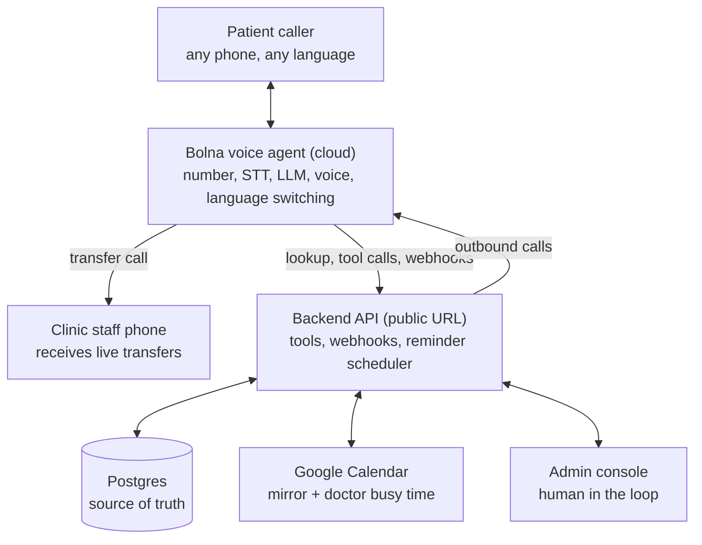

# System architecture

Notes (from Bolna docs, checked Oct 2026):
- Bolna calls the backend from three fixed IPs; the endpoint must be publicly reachable (tunnel or deployment).
- Google Calendar has no built-in Bolna integration (only Cal.com), so booking tools are custom function calls.
- Inbound caller lookup: Bolna sends the caller number to the backend and injects the returned JSON into the prompt.
- The Transfer Call tool forwards to a phone number; what happens when nobody answers is undocumented, so the backend needs a "staff on desk" check and a callback fallback.
