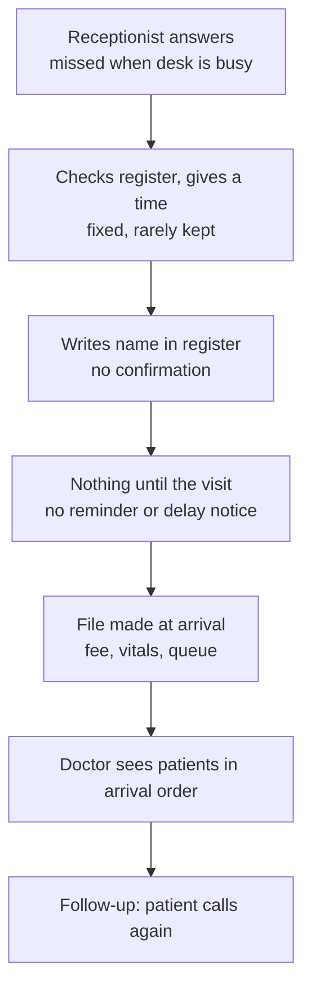
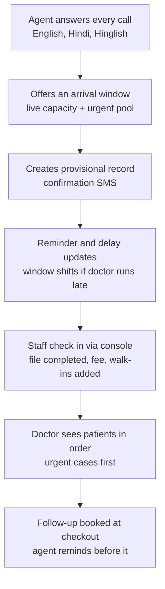

# Clinic appointment flow: today vs with the agent

## Today (typical clinic)

## With the agent and console

## Scheduling model (arrival windows + live updates)

- Each doctor session is split into arrival windows (default 30 min, 4 patients, 1 urgent place; editable per doctor).
- Caller hears a window, e.g. "come between 10:00 and 10:30".
- Staff tap "next patient" in the console; the system compares actual pace with plan and estimates delay.
- Past a threshold (proposed: 20 min), later windows get a shifted-window SMS (proposed cap: 2 delay messages per patient).
- Urgent tiers: emergency (never booked, 112/108 + alert), urgent same-day (earliest urgent place, else urgent callback), routine (next window).
- Unused urgent places are released for routine booking before the session (proposed: 2 hours before; doctor can change).
