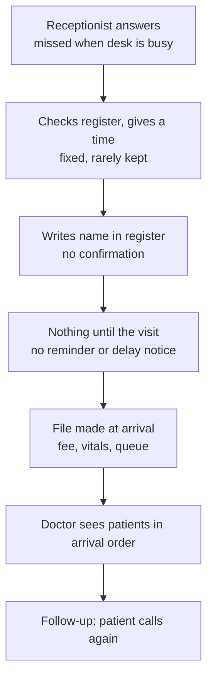
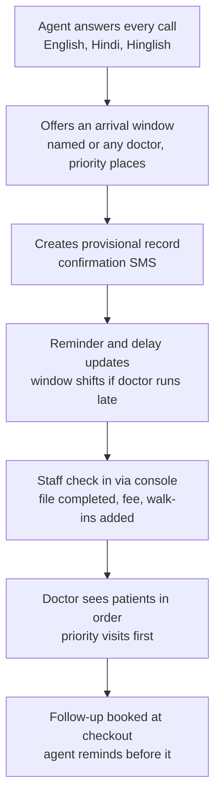

# Clinic appointment flow: today vs with the agent

## Today (typical clinic)

## With the agent and console

## Scheduling model (arrival windows + live updates)

- Each doctor session is split into arrival windows (proposed: 30 min, 4 patients, 1 priority place; editable per doctor).
- Caller hears a window, e.g. "come between 10:00 and 10:30".
- Named-doctor bookings stay with that doctor and wait if the doctor runs late. Any-doctor bookings (general check-ups, flexible follow-ups) roll over to another doctor in the pool (decided).
- The delay estimate is hybrid: it follows the planned schedule by default, and the doctor's or assistant's "Call next" taps correct it with real timing (decided).
- Past a threshold (proposed: 20 min), later windows shift and patients get a delay SMS. After 2 messages, the visit moves to the doctor's next available slot and the patient is told once (decided).
- Patients who have already arrived are never moved; they wait.
- Priority visits ("urgent" in the clinic's words) cost an extra fee and are seen before regular patients. Emergencies are separate: never booked, 112/108 and a console alert.
- Unsold priority places are released for regular booking before the session (proposed: 2 hours before; doctor can change).
- Full detail: `03-appointment-booking.md` and `09-day-of-operations.md`.
