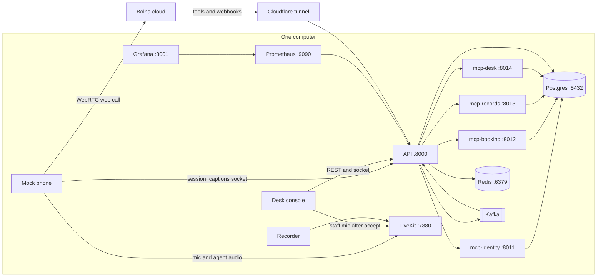
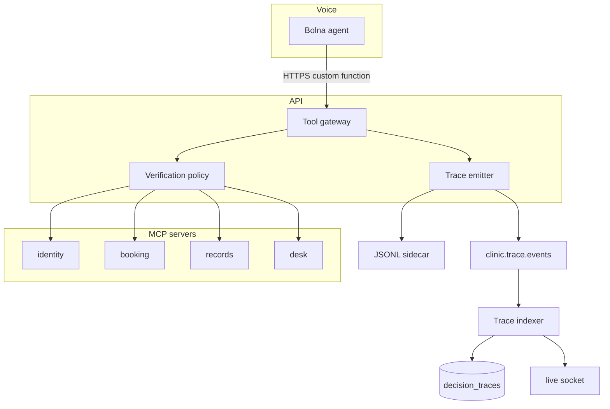
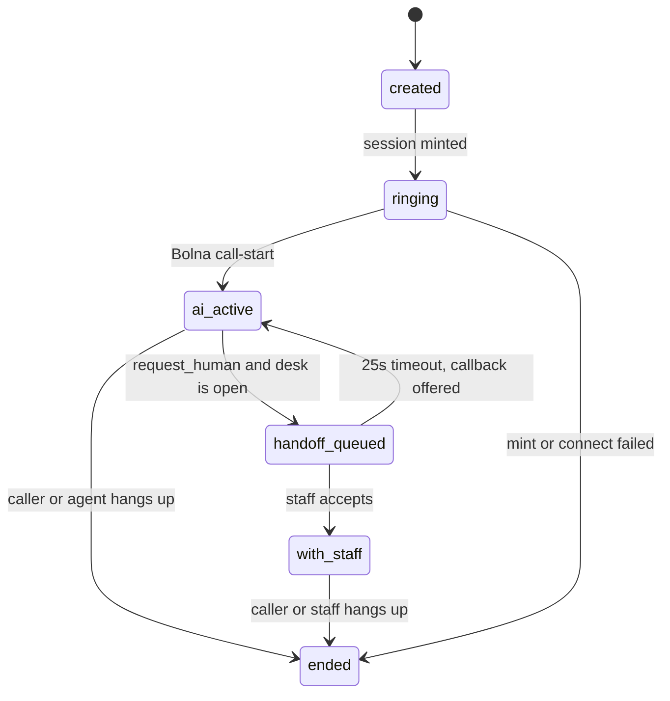
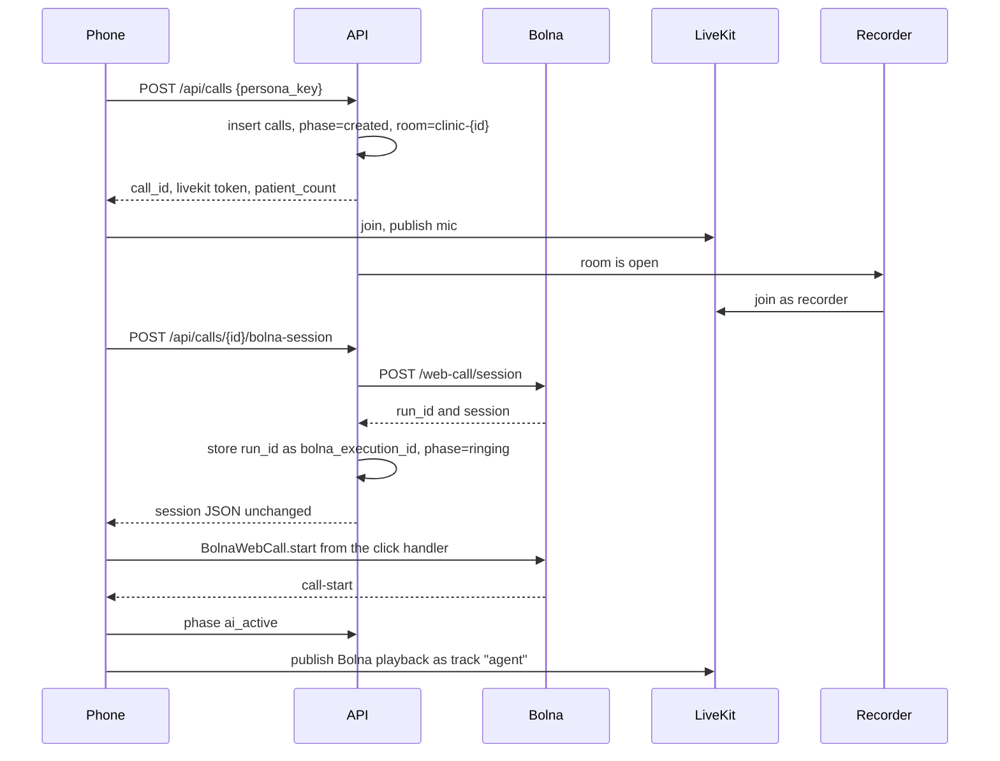
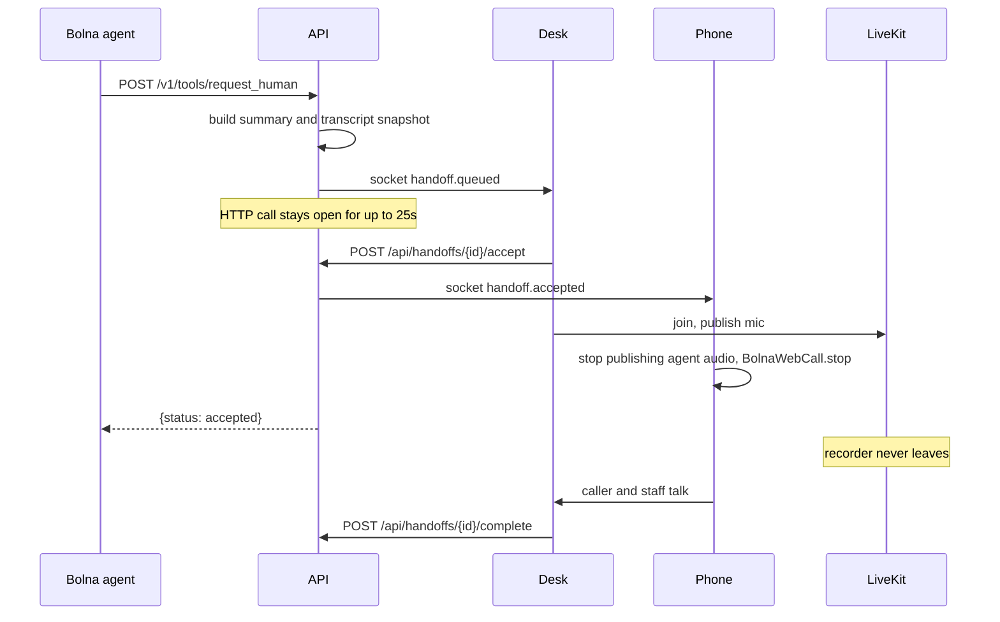
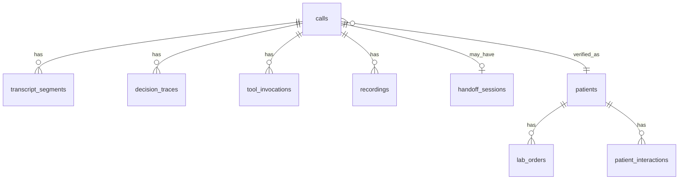

# Technical PRD — clinic voice help desk prototype

Status: ready to build. Written 18 Oct 2026 for the Bolna buildathon (submit by 31 Oct, finale 20 Nov).

This is the runtime spec for a simulated phone help desk. Product rules stay in `docs/flows/` and `docs/alignment.md`. The executable schema additions are `db/002_runtime.sql` and `db/seed_runtime.sql`. They were applied, together with `db/schema.sql` and `db/seed.sql`, on Postgres 16.

The dashboard layout is out of scope. This document defines the data, events, and APIs the dashboard reads. The mock phone can be ugly; the call has to be real Bolna audio.

## 1. What you are building

A caller opens a mock phone in the browser, picks a fictional person, and talks. Bolna runs the voice agent. Your backend is the clinic: it books visits, checks who is calling, and refuses to read one patient's file to another. A second browser window is the front desk. It shows the live decision trace, the transcript, tickets, the disposition, and the recording. When the caller asks for a person, that desk receives a summary and the transcript so far, joins the same call, and the transcript and recording keep going.

Everything you run sits on one computer. Postgres, Redis, Kafka, LiveKit, Prometheus, and Grafana bind to `127.0.0.1`. Kafka's advertised addresses are `kafka:19092` for containers and `localhost:9092` for tools on this machine. There is no second VM and no public broker address to configure.

Bolna's cloud still has to reach two routes: tool calls and the execution webhook. One Cloudflare quick tunnel in front of the API is the whole public surface. That tunnel is not the split-machine wiring this design is avoiding.

## 2. What comes from each repo

| From `bolnai-helpdesk` (this repo) | From the telephony service (shape only) |
|---|---|
| Clinic model: doctors, windows, bookings, fees, tickets, callbacks, verification rules | A call has a phase, a disposition, and an append-only event stream |
| Flows 00–11 as the agent's behaviour | Decision traces: ordered, hash-chained, written locally before they are published |
| `db/schema.sql`, `db/seed.sql`, and the 146 schema tests | Tool servers separated by what they are allowed to read |
| Demo Family Clinic, Dr Sharma, Dr Verma, Dr Kaur | Redis for the live call, Postgres for the record, Kafka for the fan-out |
| | A local LiveKit room as the media path the human joins |

The telephony repository is an internship codebase under NDA. Do not copy it into this repo. Re-implement the behaviour described here. In particular, do not bring over SIP trunks, DID numbers, a public Kafka host, Neo4j, or a second machine's database. Patient data for this product is relational. The check that used to be "is this the customer on the call?" is `require_verified_patient()` in `db/002_runtime.sql`.

Two product rules change for the prototype, on purpose:

- A verified patient can hear the **status** of a report (pending, ready to collect, already collected) and a short history of visits and calls. The agent still never reads a result, a measurement, or a diagnosis. `lab_orders` has no column for one.
- Payments, WhatsApp, SMS, and Google Calendar are rows in Postgres. The console shows the outbox. No provider is called.

## 3. Demo slice

Build these paths. Leave the rest of the flow docs as agent-prompt rules that end in a ticket or a callback, not as extra backend jobs.

| In the prototype | Simulated, not integrated |
|---|---|
| Mock phone with four personas | Real SMS, WhatsApp, UPI, DLT |
| Bolna web call (English, Hindi, Hinglish) | Google Calendar (`gcal_sync_status = 'not_needed'`) |
| Name + patient ID, and name + date of birth | Outbound reminder calls |
| Book, reschedule, cancel against the existing window rules | Live delay SMS and "call next" |
| Report status and previous interactions after full verification | Refund settlement. A refund row may be inserted; money does not move |
| Message ticket, callback row, emergency flag | SIP transfer. Handoff is inside the LiveKit room |
| Live decision trace, transcript, disposition, recording | |
| Human handoff with summary, transcript, and continued recording | |

### Personas

`db/seed_runtime.sql` loads these. Numbers are fictional.

| Key | Who | Phone | What to try |
|---|---|---|---|
| `meera` | Meera Demo, card `HC/2026/0412`, born 21 Jul 1988 | `+919822222222` | Blood test is ready to collect. Last visit was with Dr Kaur. |
| `kabir` | Kabir Demo, card `HC/2026/0413`, born 9 Jan 2018 | `+919833333333` | Blood test is pending. He is a dependant on holder `EMP-1042`. |
| `family` | Shared by Asha Demo (`482 915 6`, born 14 Mar 1961) and Rohan Demo (`736 204 9`, born 2 Nov 1994) | `+919811111111` | Two files. The agent must not say either name until one of them verifies. Asha has a collected X-ray. Rohan has no report. |
| `unknown` | No file | `+919800000099` | Hours and a new booking work. A report question must be refused. |

Asha's and Rohan's IDs are fixed in `db/seed.sql` (both pass the check digit), so the persona cards stay valid on every fresh database. Patients created during a demo get random IDs (security review S-05).

### Three-minute script

1. Start as Meera. Ask what time the clinic is open. The trace shows `get_clinic_info`. No verification.
2. Ask whether the blood test is ready. The agent asks for name and patient id, calls `match_patient`, then `get_report_status`, and says it is ready to collect at the desk. It does not say a number.
3. Ask what happened last time. `get_previous_interactions` returns the follow-up visit and the reschedule call.
4. Ask to book Dr Kaur. The agent quotes the 200 rupee appointment fee, records a yes, and writes a booking. The console shows a simulated UPI row.
5. Say "please get me the receptionist." The desk page shows the summary and the transcript up to now. Accept. Talk for a few seconds. The transcript gains `staff` rows and the recording file keeps growing.
6. Repeat step 2 as the family phone, verify Rohan, and ask about an X-ray. The tool returns no report. Asha's X-ray must not be spoken.

## 4. Architecture



MCP ports are container ports. Compose does not publish them on the host. Bolna never calls an MCP server. Bolna calls the API, and the API calls the MCP server inside the docker network.



### Processes to write

| Process | Listens | Job |
|---|---|---|
| `api` | `127.0.0.1:8000` | Mock-phone and desk REST, websocket, Bolna session mint, Bolna webhook, tool gateway, trace emitter |
| `mcp-identity` | `8011` on the docker network | `lookup_caller`, `match_patient`, `register_patient` |
| `mcp-booking` | `8012` | Windows, holds, bookings, delay |
| `mcp-records` | `8013` | Report status and previous interactions. Strictest reads |
| `mcp-desk` | `8014` | Clinic info, tickets, callbacks, emergency flag, handoff, disposition, simulated SMS and payment link |
| `recorder` | no port | Joins the LiveKit room, writes one wav, streams transcript segments |
| `web` | `127.0.0.1:3000` | Mock phone and desk UI. Your teammate designs this |

Put the four MCP servers in one image and four commands. They are separate processes because they have different read rights, not because they need to scale.

## 5. Call lifecycle



`calls.phase` is this state. `calls.ai_leg_status` is Bolna's own status and is allowed to become `completed` while `phase` is still `with_staff`. A completed Bolna webhook ends the call only when `phase` is `created`, `ringing`, or `ai_active`.

`calls.outcome` stays the coarse product value (`resolved`, `transferred`, `callback`, `emergency`, `abandoned`). `calls.disposition` is the chip on the console:

`in_progress`, `booked`, `rescheduled`, `cancelled`, `info_provided`, `ticket_created`, `callback_queued`, `transferred_to_human`, `emergency_redirected`, `abandoned`, `verification_failed`, `out_of_scope`.

The agent sets it with `set_disposition`. Staff can overwrite it while the call is `with_staff` or during the next 10 minutes. The last writer is `calls.disposition_by`.

### Placing a call



`user_data` on the mint is exactly:

```json
{
  "call_id": "15",
  "caller_phone": "+919822222222",
  "patient_count": "1",
  "clinic_name": "Demo Family Clinic"
}
```

Bolna stores `user_data` on the call and shows it in their history. Do not put a date of birth, a patient list, or a report in it. The prompt uses `{call_id}`, `{caller_phone}`, `{patient_count}`, and `{clinic_name}`.

`patient_count` is computed by the API at create time: `SELECT count(DISTINCT patient_id) FROM patient_phones WHERE phone = $persona`. The model uses it only to expect a family phone. It is not a list of names.

### Human handoff



The tool's `pre_call_message` is "Let me get someone from the desk. One moment." The mock phone stops the Bolna call when it receives `handoff.accepted`, so the agent does not keep talking over the receptionist. The LiveKit room was opened at the start of the call, and the recorder joined then. Stopping Bolna does not stop the room.

If the desk switch `clinic_settings.staff_on_desk` is off, `request_human` returns immediately with `status: closed` and the agent offers a callback. If nobody accepts in 25 seconds, it returns `status: timeout`, the handoff row becomes `timeout`, and the agent creates a callback. The Bolna call stays up in both of those cases.

There is no Bolna Transfer Call tool on this agent. Transfer Call dials a phone number, and this prototype has no number to dial.

### Recording and transcript after handoff

| Leg | Who writes it | When it exists |
|---|---|---|
| `recordings.leg = full` | Recorder, one wav under `./data/recordings/{call_id}.wav` | From the first room audio until the room is empty |
| `recordings.leg = ai_bolna` | Bolna `telephony_data.recording_url` on the `completed` webhook | After the AI leg finishes. May be null for a web call; store null and keep the local file |
| `transcript_segments` | Recorder STT the whole time. Bolna's final transcript is stored on `calls.transcript` and, if the room produced no caller/agent rows, split into segments with `source = bolna` | Append-only, including `speaker = staff` and `leg = human` |

The console plays the local wav as soon as the call ends. Until then it can show "recording in progress" from the open file size. Do not wait for Bolna's URL to claim the call was recorded.

Room STT is a small interface:

```text
push_pcm(call_id, speaker, pcm16, sample_rate) -> final segments
```

`STT_PROVIDER=whisper` uses `faster-whisper` `base` on CPU so a laptop works with no extra key. Hindi will be rough. `sarvam` or `deepgram` are the better Hindi settings when a key is present; both companies are buildathon sponsors, and either may also be selected as Bolna's own transcriber in the agent builder. The room transcriber and Bolna's transcriber are different processes. The room one exists so the human leg is transcribed after Bolna has stopped.

Publishing the Bolna playback element into LiveKit is a browser bridge (`audioElement.captureStream()`, then `publishTrack` named `agent`). Test it on the first media day. If the agent track is silent, the local wav still contains the caller and the staff, and Bolna's recording covers the AI leg. The transcript socket still works from whichever source produced segments.

## 6. Bolna

### Day-0 blocker

The web call SDK (`@bolna/web-call`, current major v3) places a browser call with no phone number and no SIP trunk. Bolna enables it per account. Ask on their Slack or at support@bolna.ai before depending on it. Until it is on, build against `POST /api/simulate/utterance` (section 11). The tool gateway, traces, and desk do not change when the voice path is switched on.

Session mint, from their docs:

```http
POST https://api.bolna.ai/web-call/session
Authorization: Bearer $BOLNA_API_KEY
Content-Type: application/json

{"agent_id": "...", "user_data": {"call_id": "15", "caller_phone": "+919822222222", "patient_count": "1", "clinic_name": "Demo Family Clinic"}}
```

The browser never sees `BOLNA_API_KEY`. `POST /api/calls/{id}/bolna-session` proxies the mint and returns the JSON unchanged. The SDK posts `{user_data}` to that route; forward it. A session expires in about 120 seconds and is single use. `run_id` from the mint is `calls.bolna_execution_id`.

Docs used for this spec, checked Oct 2026:

- Web call: `https://www.bolna.ai/docs/developer-resources/sdks/web-call`
- Custom functions: `https://www.bolna.ai/docs/tool-calling/custom-function-schema`
- Webhooks and execution payload: `https://www.bolna.ai/docs/post-call/execution-payload`
- Variables: `https://www.bolna.ai/docs/prompting/using-context`

### Agent

One Bolna agent. Languages: English, Hindi, Hinglish. Turn on `call_summary_enabled`. In the agent builder, pick a Hindi-capable transcriber and voice if the account lists Sarvam, Deepgram, or Cartesia. Do not configure Plivo or Exotel. This prototype does not buy a number.

Webhook URL: `$PUBLIC_BASE_URL/v1/bolna/webhook`, with a header `Authorization: Bearer $BOLNA_WEBHOOK_TOKEN`. Bolna sends webhooks from `13.203.39.153`, `13.126.9.249`, and `13.202.133.53`. Keep `BOLNA_ENFORCE_SOURCE_IP=0` on a laptop. Set it to `1` only after a real webhook has been seen and the tunnel is public.

Wait for status `completed` before reading `transcript`, `summary`, `conversation_duration`, or `recording_url`. `call-disconnected` is not final. Store every delivery in `calls.raw_payload` and ignore a repeat of the same `(bolna_execution_id, status)`.

### Prompt to paste

Superseded on 29 Oct 2026 by `agent/system-prompt.txt`, `agent/welcome-message.txt` and `agent/functions.json` (all 21 functions), checked by `agent/check_agent.py`. The short draft below is kept for history; do not paste it.

```text
You are the phone assistant for {clinic_name}. Your first sentence tells the caller you are an automated assistant and that the call is recorded.

The call reference is {call_id}. Pass that exact value as call_id on every tool. Never ask the caller for it, and never change it if they tell you a different one. This phone number has {patient_count} files. Never list the names on a number.

Speak English, Hindi, or Hinglish, matching the caller. Do not announce a language switch.

You do not diagnose, interpret a report, or suggest a medicine. If they describe an emergency or wanting to harm themselves, tell them to call 112 or 108, then call flag_emergency.

Hours, address, fees, and doctor days come from get_clinic_info. If it is not in the tool result, say you do not have it.

Before any fact about a person's visits, reports, or messages, call match_patient. Name plus the patient id on the card. If they do not know the id, name plus date of birth. Two failures, then offer a callback. Never say which detail was wrong. A relative may book, move, cancel, and leave a message. A relative may not hear report status or visit history; offer a callback instead.

Reports: call get_report_status and say only the status and how to collect it. Previous visits: call get_previous_interactions and use only that list.

Bookings use arrival windows. Named doctors stay with that doctor. A general check-up can use the general pool. Dr Kaur has a 200 rupee appointment fee and a 500 rupee priority fee. Say the fee and get a clear yes before create_booking. Priority is a paid earlier visit, not an emergency.

When a tool returns, the say field is the sentence you may speak. Do not add facts that are not in say or data.

If they ask for a person, or you have not understood them twice, call request_human.
When the call is ending, call set_disposition once.
```

### Custom functions

Every function has `"key": "custom_task"`. All of them `POST` to `$PUBLIC_BASE_URL/v1/tools/<name>` with `api_token` set to `Bearer $BOLNA_TOOL_TOKEN`. `param` maps each argument with `%(name)s`. The first real call should be captured once, because Bolna's body is the `param` object; also accept a wrapper `{"param": {...}}` if that is what arrives.

`match_patient`:

```json
{
  "name": "match_patient",
  "description": "Verify the caller with name plus patient id, or name plus date of birth. Call this before any patient-specific fact.",
  "pre_call_message": "One moment, I am checking the file.",
  "parameters": {
    "type": "object",
    "properties": {
      "call_id": {"type": "string", "description": "The call reference from the prompt. Do not ask the caller."},
      "full_name": {"type": "string", "description": "Patient full name, as spoken."},
      "patient_code": {"type": "string", "description": "Id printed on the card. Omit if they do not know it."},
      "date_of_birth": {"type": "string", "description": "YYYY-MM-DD. Use only when the id is unknown."},
      "phone_last4": {"type": "string", "description": "Only if a previous result was ambiguous."},
      "caller_is_patient": {"type": "boolean", "description": "False when a relative is calling."}
    },
    "required": ["call_id", "full_name"]
  },
  "key": "custom_task",
  "value": {
    "method": "POST",
    "url": "https://PUBLIC_BASE/v1/tools/match_patient",
    "api_token": "Bearer TOKEN",
    "param": {
      "call_id": "%(call_id)s",
      "full_name": "%(full_name)s",
      "patient_code": "%(patient_code)s",
      "date_of_birth": "%(date_of_birth)s",
      "phone_last4": "%(phone_last4)s",
      "caller_is_patient": "%(caller_is_patient)s"
    }
  }
}
```

`request_human` uses the same shape. Parameters: `call_id`, `reason`, `priority` (`P1`, `P2`, `P3`). `pre_call_message` as in section 5. Priority `P1` is emergency or self-harm, `P2` is distress or a failed booking, `P3` is everything else. Set `pre_call_webhook_url` to `$PUBLIC_BASE_URL/v1/bolna/pre-handoff` and `pre_call_webhook_param` to `{"call_id":"%(call_id)s","reason":"%(reason)s"}` so the desk is notified even if the main call is slow. The webhook is fire-and-forget; the main call still waits for accept or timeout.

Generate the remaining functions the same way. Names and arguments are in the next section. `call_id` is required on every one of them.

### Tool response

Return HTTP 200 for domain results, including refusals, so the agent speaks `say` instead of a generic failure. Reserve HTTP 401 for a bad bearer token and HTTP 404 for an unknown tool.

```json
{"ok": true, "say": "Your blood test is ready to collect at the desk.", "data": {"label": "Blood test", "status": "ready_for_pickup"}, "next": "continue"}
```

```json
{"ok": false, "error_code": "not_verified", "say": "I need to confirm the patient's name and the id on the card first.", "next": "verify"}
```

`next` is `continue`, `verify`, `handoff`, or `stop`. The prompt tells the model that `say` is the only sentence it may add facts from.

Writes are idempotent for 15 seconds on `(call_id, tool_name, sha256 of canonical args)`. A repeat returns the stored `response_json`. Record every attempt in `tool_invocations`.

## 7. Tools and MCP servers

The model never sends `patient_id`. The gateway deletes it if it appears, writes a `warning` trace, and uses `calls.patient_id` after verification. A tool that reads a patient calls `require_verified_patient(call_id, patient_id, allow_limited)` in the same transaction as the read.

| Tool | MCP | Who can call it | What it does |
|---|---|---|---|
| `lookup_caller` | identity | open call | `{patient_count}` for the persona phone. No names |
| `match_patient` | identity | open call | Name + id, or name + dob. See rules below |
| `register_patient` | identity | open call, after two failed matches, booking only | Inserts a provisional patient. Phone is `calls.from_number`, not a number the model supplies. Sets `verified`, `verification_mode = full` |
| `get_clinic_info` | desk | open call | Hours, address, fees, doctors. `topic` argument |
| `get_doctor_delay` | booking | open call | Schedule-only estimate for the prototype: on time unless a session row says otherwise |
| `get_available_windows` | booking | verified, full or limited | Open windows for a doctor name or the pool `General check-up` |
| `hold_window` | booking | verified | 90-second hold. Existing capacity trigger applies |
| `create_booking` | booking | verified | Named or any-doctor. Fee consent timestamp required when the doctor has a fee. `requested_by_relative` follows `caller_is_relative` |
| `reschedule_booking` | booking | verified | Moves the caller's own live booking |
| `cancel_booking` | booking | verified | Cancels the caller's own live booking |
| `get_booking_status` | booking | verified, full or limited | Upcoming bookings for the verified patient only |
| `get_report_status` | records | verified, **full only** | Label and status. No values exist |
| `get_previous_interactions` | records | verified, **full only** | Up to 5 operational rows plus live bookings |
| `create_message_ticket` | desk | verified | Refill or message. Relative flag stored. Refills: medicine as the caller read it, doctor, days left, guardian and symptom flags; never a decision (`docs/flows/11-prescription-refills.md`) |
| `create_callback` | desk | open call | P1, P2, or P3. Phone defaults to `calls.from_number` |
| `flag_emergency` | desk | open call | Inserts `emergency_alerts` and a P1 desk event |
| `request_human` | desk | open call | Section 5 |
| `send_sms` | desk | verified | Inserts `messages` with the approved template. Status `queued`. Nothing is sent |
| `create_payment_link` | desk | verified | Inserts `payments` and a WhatsApp `messages` row. `link_url` is `https://demo.local/pay/{id}` |
| `set_disposition` | desk | open call | Writes `calls.disposition` and `disposition_by = agent` |

`match_patient` rules, matching flow 02:

- All-digit codes must pass `luhn_valid` before the query. A bad check digit is a failed attempt and does not hit the table.
- Other codes match `patient_code_norm` (letters and digits, upper case), so `HC/2026/0412` matches spoken "HC 2026 0412".
- Names: casefold, strip punctuation, accept Levenshtein distance ≤ 2 when the seed name is at least 5 characters, else exact. This is Latin script, which is how the seed is written.
- Name and id must be the same row. A valid id with another name is a failure. The response does not say whose id it is.
- Name + dob with two hits returns `ambiguous` and asks for the last 4 digits of the registered mobile. Do not speak the candidates.
- Success sets `calls.verified`, `calls.patient_id`, `calls.verification_mode` (`full` if `caller_is_patient` is true, else `limited`), and `calls.caller_is_relative`. It also writes `verification_attempts`.
- Two failures and the response is `say` offering a callback. A new booking may then call `register_patient`.
- Verification lasts for this call and this patient. If the caller switches to another person, `match_patient` must succeed again before the gateway will read the new file.

Postgres errors `P0001` from the booking trigger become `ok: false` and a `say` the caller can understand ("That arrival window is full", "Dr Kaur's visit has a 200 rupee fee"). Do not return the raw exception.

Internal MCP calls use `Authorization: Bearer $INTERNAL_TOKEN` and are not routed by the tunnel.

## 8. Decision traces

One chain per call. Emitting must not raise into the tool call. Hash and sequence are assigned synchronously. Kafka publish is a background task. The JSONL line is written first, to `./data/traces/dtrace_{call_id}.jsonl`, and is the replay source if the broker is down.

Envelope:

| Field | Value |
|---|---|
| `schema_version` | `1` |
| `event_id` | UUID |
| `trace_id` | `call-{call_id}` |
| `call_id` | string |
| `clinic_id` | `1` for the demo |
| `seq` | `0` for the first event |
| `ts` | UTC ISO-8601 with milliseconds |
| `event_type` | below |
| `severity` | `info`, `warning`, or `violation` |
| `payload` | object |
| `prev_hash` | 64 zeros when `seq` is 0, otherwise the previous `record_hash` |
| `record_hash` | hex sha256 |

`record_hash = sha256(prev_hash + canonical_json(envelope without prev_hash and record_hash))`. Canonical JSON has sorted keys, separators `(',', ':')`, UTF-8 with non-ASCII left as characters, and no keys that start with `_`. Integral floats are written as integers so a later JavaScript checker matches. `verify_chain(events)` walks `seq` and returns the first mismatch.

Event types: `call_started`, `turn_user`, `turn_agent`, `turn_staff`, `tool_call`, `mcp_call`, `data_access`, `verification`, `decision`, `compliance_flag`, `escalation`, `disposition_set`, `call_ended`.

`data_access` payload includes `patient_id_accessed` and `matches_verified_patient`. A mismatch is `severity: violation` and increments `clinic_data_access_violations_total`. The read is also rejected by `require_verified_patient`, so the trace is the audit of a refusal, not of a leak.

`tool_call` payload: `tool`, `args`, `result_summary`, `success`, `latency_ms`, `rationale`. Phone-like keys in `args` keep the last 4 digits. Keys containing `token`, `secret`, `password`, or `api_key` are replaced with `"redacted"`. Date of birth in the trace is stored as a boolean `dob_provided`, not the date. The full attempt stays in `verification_attempts`.

`decision` without a `rationale` is `warning`. `escalation` is the handoff. `compliance_flag` covers emergency, a refused medical question, and a cross-patient attempt.

The indexer consumes `clinic.trace.events`, inserts on `event_id`, and publishes the row to Redis. The desk socket reads Redis. The console can also page `GET /api/calls/{id}/traces?after_seq=`.

## 9. Kafka

Single broker, KRaft, replication factor 1. Image and listeners are in `deploy/docker-compose.yml`. Containers bootstrap `kafka:19092`. A shell on the laptop bootstraps `localhost:9092`. Both listeners are PLAINTEXT. There is no `KAFKA_EXTERNAL_HOST`.

`kafka-init` creates the topics. Partition key for every message is `call_id`, so one call stays ordered.

| Topic | Partitions | Retention | Producers | Consumers |
|---|---|---|---|---|
| `clinic.call.lifecycle` | 3 | 7 days | API | indexer, optional desk fan-out |
| `clinic.trace.events` | 3 | 7 days | trace emitter | `clinic-trace-indexer` |
| `clinic.transcript.segments` | 3 | 24 hours | recorder, webhook importer | `clinic-transcript-indexer` |
| `clinic.handoff.events` | 3 | 7 days | API | `clinic-handoff-indexer` |
| `clinic.recording.events` | 1 | 7 days | recorder, webhook | `clinic-recording-indexer` |
| `clinic.dlq` | 1 | 7 days | any consumer after 3 failures | nobody automatic |

Message body:

```json
{
  "schema_version": 1,
  "event_id": "uuid",
  "call_id": "15",
  "type": "decision_trace",
  "ts": "2026-10-18T12:00:00.000Z",
  "body": {}
}
```

Producer settings: `acks=all`, `enable.idempotence=true`, `linger.ms=5`. Consumer group settings: `enable.auto.commit=false`, commit after the Postgres insert, `max.poll.interval.ms=300000`. A poison message goes to `clinic.dlq` with the original topic, partition, offset, and error string.

Postgres is the copy the console trusts. Kafka can be wiped in local dev. The JSONL sidecar is how you rebuild `decision_traces` for one call:

```bash
# replay is an API admin route, localhost only
curl -s -X POST http://127.0.0.1:8000/api/admin/traces/replay -H "X-Desk-Pin: $DESK_PIN" -d '{"call_id":15}'
```

## 10. Redis

Redis 7, no password, no disk, 128 MB, `allkeys-lru`. It holds live state. Postgres is the record. If Redis restarts, the API rebuilds the keys below from `calls` where `phase` is not `ended`.

| Key | TTL | Value |
|---|---|---|
| `call:{id}` | 6 h | Hash: phase, persona, from_number, patient_id, verified, verification_mode, bolna_execution_id, livekit_room |
| `exec:{run_id}` | 6 h | `call_id` |
| `call:{id}:lock` | 30 s | SET NX while a write tool runs |
| `desk:open` | none | `1` or `0`, mirrored from `clinic_settings.staff_on_desk` |
| channel `live:call:{id}` | | transcript, trace, phase events |
| channel `live:desk` | | `handoff.queued`, `handoff.accepted`, `emergency` |

The socket process subscribes to those channels. Publishers are the API (phase, handoff) and the indexers (trace, transcript). The emitter also publishes to `live:call:{id}` directly so the console still moves when Kafka is down.

## 11. HTTP and websocket

Desk routes require a cookie set by `POST /api/desk/login {"pin"}` compared in constant time to `DESK_PIN`. The mock phone is open on localhost and can only create calls and open sockets for a call it just created (the create response includes a short-lived `caller_token`).

Simulator route `POST /api/simulate/utterance` exists only when `SIMULATOR_ENABLED=1`, and the handler rejects the request unless the peer is loopback. It appends a caller turn, runs the named tool as if Bolna had called it, and appends an agent `say`. It does not mint a Bolna session.

| Method and path | Caller | Body / result |
|---|---|---|
| `POST /api/calls` | phone | `{persona_key}` → `{call_id, livekit_url, livekit_token, patient_count, caller_token}` |
| `POST /api/calls/{id}/bolna-session` | phone | forwards `user_data`, returns Bolna's session |
| `POST /api/calls/{id}/phase` | phone | `{phase}` for `ai_active` and client-observed end |
| `GET /api/calls?phase=` | desk | list: id, phase, persona, from last 4, disposition, started_at, verified |
| `GET /api/calls/{id}` | desk | call row, last disposition, handoff status, recording uris |
| `GET /api/calls/{id}/transcript?after_seq=` | desk or phone token | segments |
| `GET /api/calls/{id}/traces?after_seq=` | desk | decision traces |
| `GET /api/calls/{id}/recording` | desk | local wav, or 409 while the recorder still has the file open and `download=partial` is not set |
| `GET /api/personas` | phone | `caller_personas` rows |
| `POST /api/desk/login` | desk | `{pin}` |
| `GET /api/desk` | desk | `{staff_on_desk}` |
| `PATCH /api/desk` | desk | `{staff_on_desk}` |
| `GET /api/handoffs?status=queued` | desk | queue ordered by priority, then `queued_at` |
| `POST /api/handoffs/{id}/accept` | desk | status `accepted`, joins the waiter in `request_human` |
| `POST /api/handoffs/{id}/complete` | desk | `{disposition, note}` |
| `GET /api/tickets` | desk | `message_tickets`. A refill's `medicine_name` is returned only to the patient's own doctor |
| `PATCH /api/tickets/{id}` | desk | `{status: "seen"}`, or a reply to a message ticket. Never a refill decision |
| `POST /api/tickets/{id}/refill-decision` | doctor (own patients) | `{decision, note, checks_confirmed, issued_via, pin}`. The database refuses anyone but the patient's own doctor, and an approval without an in-person visit in 180 days (S-20) |
| `GET /api/callbacks` | desk | open callbacks |
| `POST /v1/tools/{name}` | Bolna | section 6 |
| `POST /v1/bolna/webhook` | Bolna | execution payload |
| `POST /v1/bolna/pre-handoff` | Bolna | fire-and-forget copy of the handoff reason |
| `GET /healthz` | anyone | `{ok: true}` |
| `GET /metrics` | prometheus on the docker network | Prometheus text |

Websocket `GET /ws?token=`. Events:

| Event | Payload |
|---|---|
| `transcript.appended` | one `transcript_segments` row |
| `trace.appended` | one `decision_traces` row |
| `call.phase` | `{call_id, phase}` |
| `handoff.queued` | the handoff row, including `summary` and `transcript_snapshot` |
| `handoff.accepted` | `{call_id, handoff_id, staff_name}` |
| `recording.ready` | `{call_id, uri}` |
| `emergency` | `{call_id, kind, snippet}` |

The handoff page renders `summary` and `transcript_snapshot` from the queued event, then follows `transcript.appended` for the rest of the call. Summary text is built in the API without a second model call:

```text
Caller: Meera Demo, verified, card on file. Phone ending 2222.
Asked for: wants the receptionist because the fee is unclear.
Done on this call: match_patient ok; get_report_status Blood test ready_for_pickup; create_booking Dr Demo Kaur window 17:00.
Open bookings: Dr Demo Kaur, today 17:00–17:30, status booked, pay at desk or simulated UPI.
Recent turns:
  caller: Please get me a person.
  agent: Let me get someone from the desk.
```

Unverified callers get "Caller not verified" and no patient name. Limited mode says "Relative, verified for bookings only" and omits report lines.

LiveKit tokens: caller can publish mic and the agent track and subscribe; staff can publish and subscribe; recorder can subscribe only. Room name `clinic-{call_id}`. Dev server keys are `devkey` / `secret`, URL `ws://127.0.0.1:7880`. Token TTL 2 hours.

## 12. Tables

Clinic tables are already defined in `db/schema.sql` and drawn in `db/README.md`. Do not duplicate them. Runtime tables are created by `db/002_runtime.sql`.



Columns added to `calls`: `phase`, `persona_key`, `livekit_room`, `ai_leg_status`, `disposition`, `disposition_by`, `verification_mode`. Existing `patient_id` remains "set only after verification".

| Table | Columns that matter |
|---|---|
| `transcript_segments` | `call_id`, `seq`, `speaker` (`caller`,`agent`,`staff`,`system`), `leg` (`ai`,`human`), `source` (`room_stt`,`bolna`,`staff`,`system`), `text_body`, `language`, `started_at`. Unique `(call_id, seq)` |
| `decision_traces` | `call_id`, `seq`, `event_id`, `event_type`, `severity`, `ts`, `payload`, `prev_hash`, `record_hash`. Unique `(call_id, seq)` and `event_id` |
| `tool_invocations` | `call_id`, `tool_name`, `args_hash`, `request_json`, `response_json`, `ok`, `latency_ms`, `created_at` |
| `recordings` | `call_id`, `leg` (`full`,`ai_bolna`), `storage` (`local`,`bolna`), `uri`, `started_at`, `ended_at`, `byte_size`. Unique `(call_id, leg)` |
| `handoff_sessions` | One per call. `status`, `priority`, `reason`, `summary`, `transcript_snapshot`, `patient_id`, `verified`, `verification_mode`, `accepted_by`, times |
| `lab_orders` | `patient_id`, `label`, `status` (`pending`,`ready_for_pickup`,`collected`), `ordered_on`, `ready_on`. No result column. Ready rows must have `ready_on` |
| `patient_interactions` | `patient_id`, `happened_on`, `kind` (`visit`,`call`,`ticket`), `summary`, `doctor_name` |
| `caller_personas` | `key`, `display_name`, `phone`, `note` |

`require_verified_patient(call_id, patient_id, allow_limited)` raises `42501` when the call is unverified, when the patient is not the verified one, or when mode is `limited` and `allow_limited` is false. `mcp-records` calls it with false. Booking reads call it with true.

Seeded reports and history are in `db/seed_runtime.sql`. Meera's blood test is ready, Kabir's is pending, Asha's X-ray is collected, Rohan has no lab row.

## 13. Metrics

The API exposes these on `/metrics`. Names are what `deploy/grafana/provisioning/dashboards/clinic.json` graphs. Grafana is at `http://127.0.0.1:3001` (`admin` / `admin`). Prometheus is at `http://127.0.0.1:9090` and keeps 24 hours.

| Metric | Type | Labels |
|---|---|---|
| `clinic_active_calls` | gauge | `phase` |
| `clinic_tool_calls_total` | counter | `tool`, `ok` |
| `clinic_tool_duration_seconds` | histogram | `tool` |
| `clinic_handoff_wait_seconds` | histogram | `result` (`accepted`,`timeout`,`closed`) |
| `clinic_data_access_violations_total` | counter | `tool` |
| `clinic_trace_publish_failures_total` | counter | `topic` |
| `clinic_verification_attempts_total` | counter | `method`, `result` |

Postgres exporter `:9187` and Redis exporter `:9121` are already in compose, for disk, connections, and memory. Kafka has no exporter in this prototype; broker trouble shows up as `clinic_trace_publish_failures_total` and a growing sidecar.

## 14. Run it on your PC

Docker and about 2 GB of spare RAM. From the repo:

```bash
docker compose -f deploy/docker-compose.yml up -d
docker compose -f deploy/docker-compose.yml ps
```

Postgres initialises from `db/schema.sql`, `db/seed.sql`, `db/002_runtime.sql`, and `db/seed_runtime.sql` only when the volume is empty. Reset with `docker compose -f deploy/docker-compose.yml down -v`.

Check:

```bash
PGPASSWORD=clinic psql -h 127.0.0.1 -U clinic -d clinic -c "SELECT key, phone FROM caller_personas;"
docker compose -f deploy/docker-compose.yml logs kafka-init
redis-cli -h 127.0.0.1 ping
```

Ports on `127.0.0.1`: Postgres `5432`, Redis `6379`, Kafka host listener `9092`, LiveKit `7880` (TCP `7881`, UDP `7882`), Prometheus `9090`, Grafana `3001`, API `8000`, web `3000`. If one of those is already taken, change only the host side of the mapping in `deploy/docker-compose.yml`. Container DNS names stay the same. On the machine where this was checked, Redis was already on `6379` and Kafka on `9092`, so those two services were left for a personal PC; Postgres initialised the four SQL files and LiveKit answered on `7880`.

Copy `deploy/.env.example` to `.env` when you start the API. Fill `BOLNA_API_KEY` and `BOLNA_AGENT_ID`. For the public tool URL:

```bash
cloudflared tunnel --url http://127.0.0.1:8000
```

Put the `https://….trycloudflare.com` origin in `PUBLIC_BASE_URL` and in the Bolna function URLs. The API allows that host only for `/v1/tools/*`, `/v1/bolna/webhook`, `/v1/bolna/pre-handoff`, and `/healthz`. Desk and simulator routes answer on loopback only.

If `livekit/livekit-server:v1.8.4` does not pull, change the tag to the current 1.x line. Dev mode uses API key `devkey` and secret `secret`.

Suggested order:

1. Compose up. Confirm personas and the six Kafka topics.
2. API plus the four MCP servers. `curl` the tools with the bearer token. No Bolna yet.
3. Trace emitter, indexer, `GET /traces`. Break the hash chain in a test and watch `verify_chain` fail.
4. Simulator utterance for the Meera script and the Rohan X-ray refusal.
5. Desk endpoints and the websocket. Your teammate can build the UI against these.
6. Enable Bolna web call. Mint a session. One real tool call captured and checked against the parser.
7. LiveKit room, recorder, handoff accept, wav still growing, staff transcript rows still appending.

## 15. Acceptance

- `family` persona: `lookup_caller` returns `patient_count: 2` and no names.
- Verifying Rohan then calling `get_report_status` returns an empty list. Asha's X-ray is not in the payload. `decision_traces` has no `violation` for this, because the tool never asked for Asha.
- A hand-crafted tool body that includes Asha's `patient_id` while Rohan is verified is dropped. The trace is `violation`. `require_verified_patient` raises `42501` if the MCP is called anyway.
- Meera, fully verified, hears ready-for-pickup and the two seeded interactions, and not Kabir's pending test.
- `unknown` can hear hours and cannot hear a report.
- Limited mode (Kabir's file opened with `caller_is_patient: false`) can hold a window and cannot read `lab_orders`. This was executed against the function: limited mode raised `42501`.
- Handoff accept delivers `summary` and at least the turns already stored. After accept, a new caller utterance and a staff utterance both appear with `seq` greater than the snapshot, `leg = human` for the staff row, and the wav size increases.
- Bolna `completed` during `with_staff` sets `ai_leg_status` and leaves `phase` at `with_staff`.
- A repeated webhook with the same execution id and status does not insert a second call.
- `GET /metrics` shows the tool histogram after one simulated tool call. Grafana's "Clinic voice prototype" dashboard loads.

## 16. Risks

| Risk | What to do |
|---|---|
| Web call not enabled on the Bolna account | Ask Bolna first. Use the simulator so the desk is not blocked |
| Custom-function JSON shape differs from `param` | Capture one request before writing a strict parser |
| Bolna web calls have no `recording_url` | The local wav is the demo recording |
| Agent audio does not republish into LiveKit | Caller and staff are still recorded; AI audio falls back to Bolna |
| Whisper is weak on Hindi | Switch `STT_PROVIDER` or rely on Bolna's transcript for the AI leg and Whisper for the staff leg |
| Public tunnel URL changes every time `cloudflared` restarts | Update `PUBLIC_BASE_URL` and the Bolna tool URLs together |
| A caller talks the model into a different `call_id` | Gateway accepts `call_id` only when it equals the open call for this `bolna_execution_id` once the execution id is present on the tool request. Until then, bearer token plus "call phase is `ai_active`" is the gate. Log `execution_id_missing` |
| Laptop sleeps mid-demo | The tunnel dies and tools fail. The agent should speak the tool's failure `say` and offer a callback |

## 17. Out of scope

A real phone number, a SIP trunk, outbound dialling, a payment gateway, WhatsApp approval, DLT registration, Google Calendar, multi-clinic row-level security, and any clinical content. One clinic, one desk PIN, fictional patients.
