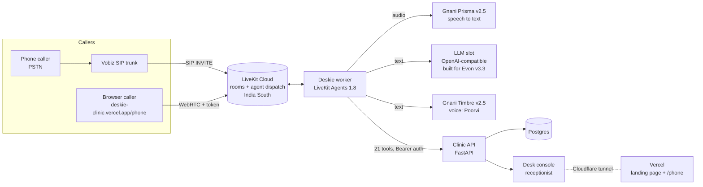

# Deskie: the clinic phone desk that never misses a call

> **When the doctor is busy, the phone still gets answered.**
> Deskie is a voice front desk for small Indian clinics. It speaks English, Hindi and Hinglish, books visits from the clinic's own records, refuses to give medical advice, sends emergencies straight to people, and puts a person on the line when a caller asks for one.
> It is built on **Gnani AI's Prisma (speech to text) and Timbre (text to speech)**, runs on **LiveKit Agents** and connects to real phone lines over **SIP (Vobiz)**.

**Live:** https://deskie-clinic.vercel.app · **Talk to it in your browser:** https://deskie-clinic.vercel.app/phone · **Code:** https://github.com/Anupamgt/bolnai-helpdesk-

---

## 1. The problem nobody answers

A small Indian clinic has one landline, one receptionist and one doctor. The phone rings while the receptionist is checking a patient in, collecting a fee or calming a waiting room. After hours, nobody picks up.

Each missed call is someone who:
- wanted to book and went to the next clinic on Google Maps,
- wanted to know if the doctor is running late and drove in anyway,
- had a report ready and called three more times, or
- had chest pain and needed a human, fast.

The tools on offer don't fit. IVR menus ("press 1 for…") don't cope with a caller who says *"kal Dr. Sharma ke saath general check-up ka time hai kya?"* Big hospital call centres are priced for hospitals. Chatbots don't answer phones.

**Deskie answers that phone.**

## 2. What makes Deskie different

Most voice-AI demos are a model wired to a phone number. Deskie is a **front desk**: the voice agent, the clinic's records, the receptionist's screen and the safety rules work together as one product.

| | Typical voice bot | Deskie |
|---|---|---|
| Language | English, or a language picker | English, Hindi and **Hinglish in the same sentence**, with Indian names and numbers read naturally (Gnani Prisma + Timbre) |
| Knows the clinic | Reads an FAQ | **21 live tools** on the clinic's own database: patients, doctors, arrival windows, bookings, reports, refunds, refills, callbacks |
| Who's calling | Trusts the caller | **Identifies callers from their phone number** and knows **one phone can belong to a family**. It verifies the person before sharing anything private, and refuses report details to unknown callers |
| Emergencies | Keeps talking | **Emergency words stop the script**: it flags the emergency, alerts the desk and hands over to a human |
| Medical advice | Might hallucinate some | **Never gives medical advice.** Fixed, pre-approved lines for medical questions, refills and payment secrets |
| The receptionist | Sees nothing | **A live desk console**: queue, doctor-delay chips, bookings made by the agent, callbacks with priority (P1–P3), emergency alerts, refund and refill decisions |
| Bookings | "Slots" | **Arrival windows**, the way Indian OPDs actually run, plus live **doctor-delay** answers ("Dr. Sharma is running 40 minutes late") |
| Measured by | Minutes talked | **Saved calls**: calls the desk could not take that still ended in the right outcome |

We designed every flow from how Indian clinics already work: shared family phones, walk-ins mixed with bookings, "doctor sahab kitni der mein aayenge?", report pickups and refill requests. We did not adapt a Western call-centre template.

## 3. Watch a call

```text
Caller (Hinglish):  Hello, mujhe kal general check-up ke liye appointment chahiye.
Deskie:             Aap naye patient hain. Kya aap mujhe batayenge ki appointment kis ke liye chahiye?
                    Aapka poora naam aur janm ki tareekh (ya umar) bataiye.
Caller:             Mera naam Arjun Test hai, meri age tees saal hai.
Deskie:             Maine aapka file bana diya hai aur main aapko patient id SMS ke zariye bhej dungi.
                    Ab aap mujhe batayein, aap kis doctor se appointment chahte hain?
```

This is a real transcript from our automated end-to-end voice test over LiveKit Cloud. Behind those two turns, Deskie called `lookup_caller`, `register_patient`, `get_available_windows`, `hold_window` and `create_booking`, and the booking appeared on the receptionist's console with the source **agent**.

## 4. Product tour

**For the caller (phone or browser):**
- Book, change or cancel a visit; ask if the doctor is running late
- Check whether a report is ready (after verification)
- Leave a message, ask for a refill, request a refund or a payment link
- Ask for a person at any time. Deskie says *"Please stay on the line, I'm connecting you to the desk"* and pages the desk. If nobody is free, it books a callback with the right priority.

**For the receptionist (desk console, `/?live=1`):**
- Live queue and each doctor's delay, worked out from the actual check-ins
- Every booking, callback, ticket and alert the agent created, live
- Emergency alerts that stay up until someone acknowledges them
- Refund and refill decisions, walk-ins, cancelled sessions, the day's call log

**For the clinic owner:**
- One north-star number: **saved calls per week**
- Pricing per answered call (Starter ₹3,999 for 200 calls, Clinic ₹9,999 for 500), from the go-to-market plan in `docs/gtm.md`
- On our working assumptions, a Clinic-tier clinic recovers about **₹30,000 a month** in visits that would otherwise have been lost (`docs/metrics.md`)

## 5. How it works



**One call, step by step:**
1. **Room.** The browser demo phone asks the clinic API for a call. The API creates the call row and mints a LiveKit token whose room config **dispatches the `deskie` agent**. A phone call arrives through the Vobiz SIP trunk, and a LiveKit dispatch rule puts it in a fresh `call-` room.
2. **Session.** The LiveKit worker joins and loads the caller context: phone number, how many patient files share that number, and the channel. It fills the system prompt and speaks the fixed welcome line, which includes the recording notice.
3. **Hearing.** Caller audio streams to **Gnani Prisma**, which is trained on telephonic Indian speech, so Hinglish arrives as text you can act on (*"namaste mujhe kal doctor sharma ke saath appointment book karni hai"*).
4. **Thinking.** The LLM plans the turn and calls the clinic's **tools**. LiveKit runs each tool call, and the API applies the clinic's rules: no booking without a held window, no report without verification, a new patient can only book a regular visit.
5. **Speaking.** **Gnani Timbre** voices the reply with Indian prosody for names, times and rupees. A small stream filter strips internal labels so the caller never hears prompt jargon.
6. **Memory.** The session's chat history is the call's working memory. Past interactions come back on the next call through `get_previous_interactions`. When the call ends, the worker posts the full transcript and duration to the clinic API, and the call shows on the console.
7. **People.** `request_human` pages the desk and waits. If staff accept, the AI mutes itself, and on a SIP call the caller can be transferred to the desk number. If nobody answers in time, a prioritised callback is created.

### Gnani AI technology used

| Model | Role in Deskie | Settings |
|---|---|---|
| **Prisma v2.5** (speech to text) | Every caller turn, streaming, through `livekit-plugins-gnani` | `en-IN` streaming at 16 kHz. It returns Hinglish as natural Roman script, which the LLM handles best. We also tested `hi-IN`, which gives exact Devanagari |
| **Timbre v2.5** (text to speech) | Every agent turn, streamed over SSE | Voice **Poorvi** (made for Hinglish), language `auto` |
| **Evon v3.3** (reasoning) | The agent's LLM slot is an OpenAI-compatible client built for Evon v3.3, with its thinking switch exposed (`EVON_THINKING`) and its model id as the default | Evon is open weights (30B MoE) with no hosted endpoint. **The live demo uses gpt-4o-mini through the same slot**, because a 30B model doesn't fit our 4 GB laptop GPU. Pointing `EVON_BASE_URL` at a vLLM/SGLang server running Evon swaps it in with no code change |

### LiveKit does the heavy lifting

| Need | LiveKit feature we use |
|---|---|
| Creating agents | `WorkerOptions(agent_name="deskie")`: a named worker registered to LiveKit Cloud (India South) |
| Rooms and sessions | One room per call (`clinic-<id>` for browser calls, `call-…` for SIP); `AgentSession` with Silero VAD and the multilingual turn detector |
| Dispatch | Token room-config dispatch (browser) and a SIP dispatch rule (phone) |
| Tool calls | 21 `RawFunctionTool`s generated from `agent/functions.json`; the same schema the static checker validates |
| Memory | Session chat history in the call, and the transcript stored at the end; earlier calls are recalled through tools |
| Telephony | `sip_setup.py`: inbound trunk with Krisp noise cancellation, dispatch rule, outbound trunk, `create_sip_participant` for outbound calls, `transfer_sip_participant` for handoff |
| Hang up | An `end_call` tool that waits for the goodbye to finish playing, then deletes the room |

## 6. Safety is the product

Clinics can't use a voice agent they can't trust. The safety limits block a release:

- **Emergency routing: 100%.** Chest pain, breathlessness and similar words call `flag_emergency` and `request_human`, and an alert stays on the console until a person acknowledges it.
- **Zero medical advice.** Medical questions get a fixed, clinic-approved line and an offer to pass a message to the doctor.
- **Zero details to unverified callers.** Report status and visit history need the patient's name plus a date of birth or card number. Our eval checks that an unknown caller is refused.
- **Deskie never approves a refill.** A refill request becomes a ticket, and the doctor decides on the console.
- **Consent first.** Every call opens by saying it is automated and recorded.
- **Internet-safe by default.** Desk endpoints accept only local traffic or a signed-in desk session. Requests that arrive through a tunnel or proxy are never treated as local, and the public demo phone is opt-in and rate-limited per IP and overall (unit tested: `api/tests/test_proxy_auth.py`).

The full reasoning is in `docs/decision-log.md` (decisions D-01 to D-40), `docs/security/threat-model.md` and the flow trees in `docs/flows/` (00 to 12).

## 7. Proof that it works

| Test | What it does | Result |
|---|---|---|
| **End-to-end voice calls** (`voice/tests/e2e_call.py`) | A bot caller joins a real LiveKit Cloud room and speaks through Gnani Timbre; Deskie hears it through Gnani Prisma, calls tools and answers by voice | **Pass** in English and Hinglish, locally and through the public internet path. The first word comes about 4–5.5 s after the caller stops, measured with 1 s of trailing silence included |
| **Conversation evals** (`voice/tests/conv_eval.py`) | The real prompt, real tools, real database and a second LLM playing the caller | **6 of 6 pass**: clinic hours, report after verification, Hinglish new-patient booking, emergency, refusing an unknown caller, asking for a human |
| **Static agent checks** (`agent/check_agent.py`) | 91 checks between the prompt, the tool schemas and the backend | **All pass** |
| **Proxy and demo auth** (`api/tests/test_proxy_auth.py`) | Tunnel traffic is never local; demo caps work | **12 of 12 pass** |
| **Clinic API tests** (`api/tests/`) | Tools, webhooks, handoff | 13 of 13 passed before the deploy-time auth change. **Not re-run since** |

Bugs we found and fixed through testing:
- The model sometimes read a line's internal label aloud ("DATA LINE: …"). A streaming filter now removes these before speech and transcripts.
- Up to 25 seconds of silence while the desk was paged. A hold line now plays first.
- The tunnel made every internet request look local. Fixed before anything went public.

## 8. Deployment

| Part | Where it runs |
|---|---|
| Landing page and demo phone | **Vercel**: https://deskie-clinic.vercel.app (`/phone` and `/api/*` are rewritten to the backend) |
| Clinic API, database and desk console | Our machine, exposed through a **Cloudflare tunnel** |
| Voice worker | Our machine, registered to **LiveKit Cloud** (India South) |
| Speech | **Gnani AI** cloud APIs (Prisma, Timbre) |
| Phone line | **Vobiz** SIP trunk to the LiveKit SIP inbound trunk (`voice/sip_setup.py inbound`). Our own trunk credentials were not ready by the deadline, so the published phone number still runs on our earlier Bolna + Vobiz integration. The browser path is the LiveKit + Gnani build |

`deploy/vercel-sync.sh <backend-url> --prod` re-points the site whenever the backend URL changes.

## 9. Where it goes next

1. **Evon v3.3 on our own GPU.** Self-host the open weights with vLLM, so the whole conversation runs on Indian models on infrastructure the clinic controls: Gnani's sovereign Artha stack, end to end.
2. **Prisma v3 `indic-auto`.** Automatic language detection, so a Tamil or Bengali caller is answered in their own language without a picker.
3. **Our own Vobiz number on LiveKit SIP**, with Krisp noise cancellation for crowded waiting rooms and calls on the street.
4. **Outbound calls:** appointment reminders and "your report is ready" calls (the flow is designed in `docs/flows/07-outbound-calls.md`).
5. **WhatsApp follow-ups** after every call.
6. **Pilot** with design-partner clinics, measuring save rate against the 60% pilot target.

## 10. Team

Built for **The Great Indian AI Internship Challenge** by Gnani AI.

| Member | Contribution |
|---|---|
| _Name_ | _e.g. voice agent, LiveKit + Gnani integration, telephony, testing, deployment_ |
| _Name_ | _e.g. product design, flows, clinic backend, desk console_ |

`#GnaniAI` `#GreatIndianAIInternshipChallenge`
